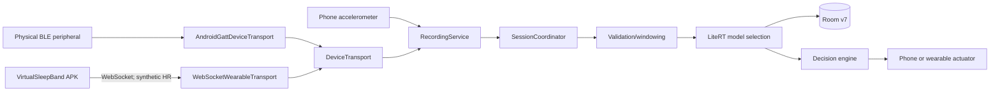

# SleepSense 2.0 architecture

## Runtime boundaries

SleepSense (`com.example.sleeptrackersimulator`) and VirtualSleepBand (`com.example.virtualsleepband`) are independently installable APKs. SleepSense owns phone accelerometer ingestion, recording, inference, Room, analytics, Firebase outbox processing, and phone actuators. VirtualSleepBand owns synthetic HR generation and exposes two distinct transports: a physical BLE GATT peripheral and an RFC 6455 WebSocket server on port 8765.

`SwitchingDeviceTransport` selects either physical GATT or independent WebSocket. The previous in-process `MockDeviceTransport` remains as test-support code but is no longer wired into production DI. The main APK's local BLE advertiser is no longer wired into the UI or application container.

## Failure behavior

Socket connection alone is insufficient. The client becomes `CONNECTED` only after a valid `DEVICE_INFO` in the negotiated session. HR freshness is 10 seconds. Heartbeats use elapsed realtime and close the socket after 15 seconds without valid traffic. Disconnect clears device and last-HR state; phone accelerometer recording continues. Duplicate/out-of-order sequence numbers and messages from another session are ignored.

The WebSocket default is `ws://10.0.2.2:8765`. This is an emulator-host address, not an emulator-to-emulator address. See `VIRTUAL_WEARABLE.md` for routing.

## Verified component inventory

| Component | Source | Responsibility | Status / weakness |
|---|---|---|---|
| Recording service | `service/RecordingService.kt` | Foreground lifecycle, accelerometer listener, HR collection | VERIFIED_WORKING by JVM/build coverage; device lifecycle E2E UNVERIFIED |
| Physical transport | `data/ble/AndroidGattDeviceTransport.kt` | Scan, GATT, CCCD, HR parsing, commands | Code/tests VERIFIED; physical radio ENVIRONMENT_BLOCKED |
| Virtual transport | `data/ble/WebSocketWearableTransport.kt` | Session, validation, HR, heartbeat, commands | Build/unit contract VERIFIED; two-emulator runtime UNVERIFIED |
| Virtual server | `virtualsleepband/.../VirtualWearableWebSocketServer.kt` | Independent HR source and simulated command result | Build VERIFIED; cross-APK runtime UNVERIFIED |
| Room | `history/SleepTrackerDatabase.kt`, `data/sessions/*` | v1-v7 additive schema and repositories | Migrations/tests present; new transport uses existing provenance column |
| ML | `ml/*`, `assets/*.tflite` | Accel and optional-HR model inference | Synthetic training only; real validity NOT_IMPLEMENTED |
| Firebase | `cloud/*` | opt-in sync with durable Room outbox | Unit/integration tests present; live backend UNVERIFIED |
| Actuators | `actuator/*` | decision and Android execution | Safety tests present; physical flashlight/vibration ENVIRONMENT_BLOCKED |

