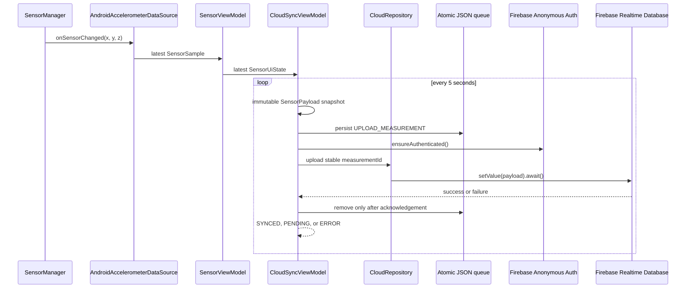

# Sleep Tracker Simulator

Android educational project combining independent phone and virtual-wearable sensor streams. It is not a medical application or sleep-stage detector.

## Lab 1 — phone movement

`AndroidAccelerometerDataSource` observes the phone accelerometer. `MovementClassifier` smooths changes between acceleration vectors and exposes `STILL` or `MOVEMENT` through `SensorViewModel` and `StateFlow`. This pipeline remains live with BLE disconnected, scanning, connecting, connected, and after disconnect.

## Lab 2 — Virtual Sleep Band

`VirtualSleepBand` models an external BLE heart-rate wearable. The transport remains software-based, while its lifecycle and profile mirror a concrete BLE sensor:

- scan and discover `Sleep Band HR [VIRTUAL:HR:01]`;
- connect and discover Heart Rate Service `0x180D`;
- subscribe to Heart Rate Measurement `0x2A37`;
- receive smooth, bounded heart-rate measurements through simulated Notify;
- Read Body Sensor Location `0x2A38`;
- Write `START_STREAM`, `STOP_STREAM`, or `REQUEST_STATUS`;
- reject unknown commands.

The generator uses a bounded random walk from a configurable initial BPM. Its interval and variation source are injectable. The most recent 60 measurements feed the live Compose Canvas graph.

## Combined Rest-State Estimation

`RestStateClassifier` combines phone movement, movement intensity, continuous still duration, current wearable HR, and a recent HR window. It produces:

- `MONITORING` — wearable or sensor data is unavailable, or an HR baseline is still being collected;
- `ACTIVE` — the accelerometer detects movement;
- `RESTING` — movement is low for a sustained period without enough evidence for possible sleep;
- `POSSIBLE_SLEEP` — prolonged uninterrupted stillness and stable recent HR occur together.

HR stability uses both population standard deviation and range. No absolute BPM threshold determines sleep. Classroom defaults intentionally shorten the temporal thresholds: `RESTING` after 3 seconds and `POSSIBLE_SLEEP` after 12 seconds, with at least 5 HR samples. These demonstrate transitions during a short lab session; they are not physiological thresholds.

This is an educational heuristic and not a medical sleep-stage classifier.

```text
Android Accelerometer
        |
        v
MovementClassifier
        |
        +-------------------+
                            |
                            v
                    RestStateClassifier
                            ^
                            |
Virtual Sleep Band          |
        |                   |
        v                   |
Mock BLE Connector          |
        |                   |
        v                   |
Heart Rate Measurement -----+
                            |
                            v
                       RestState
                            |
                            v
                       Compose UI
```

`SensorViewModel` and `BleViewModel` remain independent. `RestStateViewModel` combines their immutable `StateFlow` outputs without making either source ViewModel depend on the other.

## Lab 3 — Firebase Realtime Database

`CloudSyncViewModel` snapshots the latest sensor, BLE, and derived rest state every five seconds. This interval is short enough for a laboratory demonstration and long enough to avoid sending every accelerometer event. It owns one idempotent producer job, while a `Mutex` serializes session creation, queue draining, and session closure. Compose contains no Firebase calls.

Each measurement receives a UUID before it enters the queue. Firebase writes use that UUID as the key, so a retry overwrites the same logical record instead of creating duplicates. A session also has a stable UUID and is restored after process death. `End Monitoring` persists a typed `END_SESSION` operation. While the application process remains alive, one lifecycle-bound recovery job retries it at five-second intervals without a busy loop. After process death, delivery resumes only when the application is launched again; this project does not claim WorkManager-style background delivery.

`value` is the smoothed movement intensity in m/s². It is duplicated as `movementIntensity` so the generic laboratory field and the domain-specific meaning are both explicit. The logical `deviceId` is `sleep-tracker-simulator`; no hardware or personal identifier is collected.



Authenticated database shape:

```text
users/{auth.uid}/sessions/{sessionId}
├── schemaVersion, deviceId, startedAt, endedAt
└── measurements/{measurementId}
    ├── measurementId, deviceId, sensorType, timestamp
    ├── x, y, z, value, movementIntensity
    └── movementState, heartRateBpm, bleConnected, restState
```

Pending operations are stored in an app-private atomic JSON file backed by Gson. The bound applies to 50 telemetry operations, equivalent to about 4 minutes 10 seconds of five-second samples. On overflow, the oldest telemetry measurement is discarded, the durable dropped-telemetry counter is incremented, and `END_SESSION` control operations are preserved outside that telemetry limit. Therefore cloud telemetry is explicitly best-effort and bounded, not lossless. Room remains the durable local measurement history. When validated internet returns, operations are sent oldest first. An acknowledged measurement is removed using its stable Firebase key; an acknowledged `END_SESSION` and its active-session marker are cleared in one atomic local-state write. Transient network/server failures use bounded request backoff delays of 500, 1000, and 2000 ms; persisted outbox recovery continues at a controlled five-second interval while the process is alive.

`SensorPayloadValidator` rejects non-finite or implausible sensor values, invalid enums, future timestamps, and malformed identifiers before queueing. Anonymous Firebase Authentication supplies the owner UID. `database.rules.json` defaults to deny, restricts telemetry to `/users/{auth.uid}`, and validates the expected schema and value ranges. No email, advertising ID, Android hardware identifier, account name, or location is collected; the fixed `deviceId` is a logical lab identifier.

Retention runs only after a completed session: completed sessions older than 30 days and completed sessions beyond the newest 30 are removed. The active session, unfinished sessions, and unrelated database branches are never selected.

Firebase Console setup required for a clean project:

1. Enable Authentication > Sign-in method > Anonymous.
2. Deploy `database.rules.json` with Firebase CLI (`firebase deploy --only database`) or paste the rules in Realtime Database > Rules and publish them.
3. Keep the configured Realtime Database region and `google-services.json` aligned with this Android application.

Cloud tests use coroutine virtual time and in-memory or temporary-file fakes. They cover scheduling, duplicate-start prevention, payload snapshots, status transitions, FIFO bounds and recovery, atomic persistence, validation boundaries, bounded retry, retention selection, cancellation, restart, and session end without contacting Firebase.

Logcat tag `CloudSync` reports successful, pending, and failed uploads without logging payload values or Firebase configuration.

## Lab 4 — Actuator Control

`DecisionEngine` receives the existing smoothed movement intensity from `SensorViewModel`. It is a pure Kotlin edge detector with an educational threshold of `0.65 m/s²`: a transition from below to `>=` the threshold while movement is classified as `MOVEMENT` produces one vibration pulse. Remaining above the threshold produces no repeated alerts; dropping below rearms it. Automatic movement alerts can be disabled without disabling manual or remote control.

```text
SensorManager → MovementClassifier → SensorViewModel → DecisionEngine
                                                        |
                                              threshold crossed?
                                                /             \
                                              no              yes
                                              none      vibration pulse
```

`AndroidSmartActuator` uses `VibratorManager` and `VibrationEffect` for pulse or persistent vibration. Flashlight control uses `CameraManager.setTorchMode()` only after checking `FEATURE_CAMERA_FLASH`, selecting a flash-capable camera, and checking camera permission. Missing hardware and API failures are represented as `UNAVAILABLE` or `ERROR`; the UI never claims that unavailable hardware is active. Automatic control uses vibration only. Flashlight is reserved for Manual Control and Firebase commands.

Cloud-to-device commands use a separate event-driven path from Lab 3 telemetry:

```text
Firebase RTDB users/{auth.uid}/control/sleep-tracker-simulator
        ↓ ValueEventListener (not polling)
FirebaseRemoteControlRepository
        ↓ callbackFlow
ActuatorViewModel
        ↓
SmartActuator → VibratorManager / CameraManager
```

The typed remote node is:

```json
{
  "users": {
    "{auth.uid}": {
      "control": {
        "sleep-tracker-simulator": {
          "vibrationEnabled": false,
          "flashlightEnabled": false
        }
      }
    }
  }
}
```

`awaitClose` removes the Firebase listener when collection is cancelled. `ActuatorViewModel.onCleared()` cancels its collectors and calls `stopAll()` so repeating vibration and torch do not remain active. `Disconnect Sleep Band` still affects only BLE; `End Monitoring` still affects only Lab 3 telemetry. Local, manual, and Firebase actuator controls remain independent of both.

Event-driven control reacts when Firebase invokes the listener after a server-side change. Polling would repeatedly ask the server whether a value changed; Lab 4 does not poll.

The actuator tests cover threshold edges and rearming, no-spam behavior, automatic enable/disable, manual and remote commands, unavailable hardware, remote errors, operation failures, and cleanup. Emulator flashlight availability depends on its virtual hardware profile; `Flashlight unavailable` is the correct result when the feature is absent.

## Verification

```powershell
.\gradlew.bat testDebugUnitTest
.\gradlew.bat assembleDebug
```

## Lab 5 — Room history and analytics

Processed `MovementAnalysis.motionIntensity` values are stored locally in Room about once per second while the activity-scoped recorder receives valid accelerometer samples. This path does not depend on BLE, Firebase authentication, cloud monitoring, or Internet connectivity.

```text
SensorManager → SensorViewModel → LocalHistoryRecorderViewModel
                                      ↓
                              SensorHistoryRepository
                                      ↓
                         Room DAO → sleep_tracker.db
                                      ↓ Flow
                              AnalyticsViewModel
                                      ↓
                         Compose Analytics + Vico
```

The `sensor_records` table contains `id`, Unix `timestamp` in milliseconds, smoothed `sensorValue` in m/s², and `actionTriggered`. Successful vibration pulses and successful transitions that enable persistent vibration or flashlight are emitted as one-shot typed activation events. Disable, unavailable, and failed operations do not create activations. A pending activation is cleared only after a Room insert succeeds.

Analytics displays a rolling one-hour window. SQL selects the newest 50 records using `timestamp DESC, id DESC`, then returns those records in chronological order for Vico. Counts cover the complete one-hour window and refresh reactively through Room `Flow`.

Additional verification commands:

```powershell
.\gradlew.bat lintDebug
.\gradlew.bat compileDebugAndroidTestSources
.\gradlew.bat connectedDebugAndroidTest
```

For Database Inspector evidence, run the debug app, open **View > Tool Windows > App Inspection**, choose **Database Inspector**, select `sleep_tracker.db`, and open `sensor_records`. The database uses WAL, so keep the app process running while inspecting it.

Educational simulation; not a medical sleep-stage detector.
