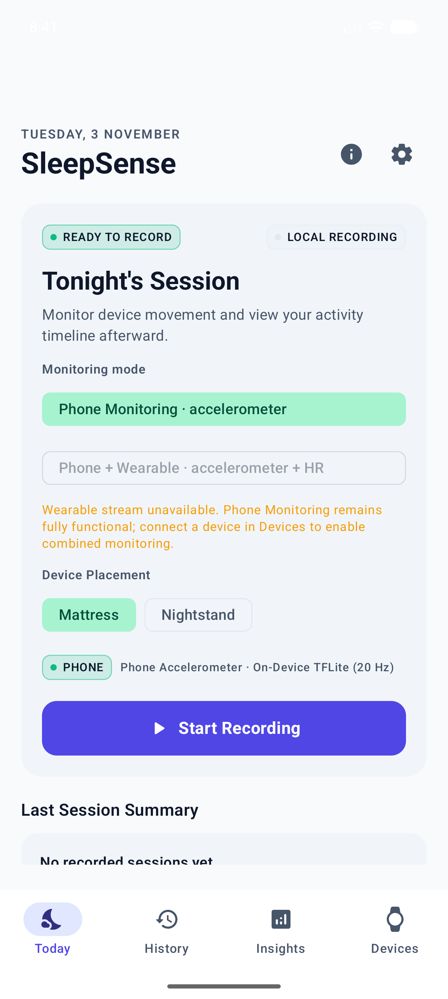
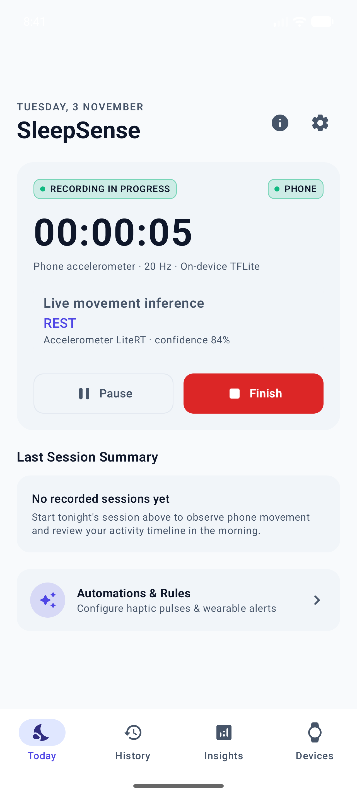
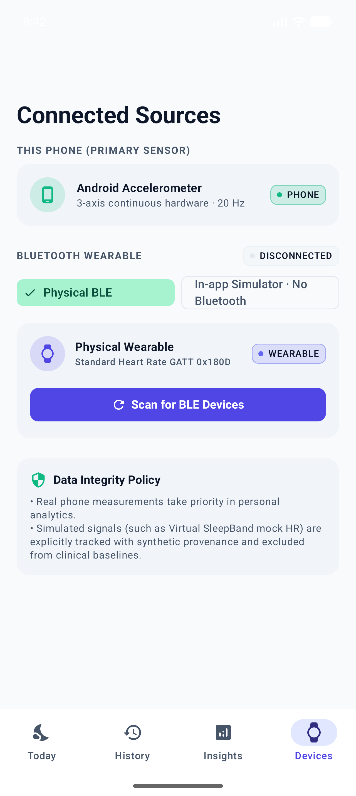

# SleepSense 2.0

**Android movement and rest monitoring with on-device ML, local history, an optional wearable transport, and a reproducible Python data pipeline.**

SleepSense is an engineering prototype, not a clinical sleep-stage detector. Its model outputs are movement states (`REST`, `RESTLESS`, `ACTIVE`), not REM/NREM stages. The bundled models are trained on synthetic data; real-world validity has not been established.

## Product

| Recording and analysis | External signals | Data and deployment |
| --- | --- | --- |
| Foreground accelerometer recording, pause/resume, session history, movement summaries, LiteRT inference | Real BLE GATT HR peripherals **or** an independent VirtualSleepBand APK over WebSocket | Room v8, opt-in Firebase outbox, Python/Polars/Parquet/DuckDB pipeline |



| Recording / ML | Devices / virtual band |
| --- | --- |
|  |  |

## Architecture

Two independently installable Android applications:

- `app/` — SleepSense: Jetpack Compose, `RecordingService`, `SessionCoordinatorImpl`, on-device inference, Room and opt-in cloud delivery.
- `virtualsleepband/` — synthetic heart-rate generator and a WebSocket server; a GATT peripheral implementation is also present.
- `wearable-protocol/` — shared Kotlin wire-protocol source, included in **both** APK source sets. It is **not** a standalone Gradle module.
- `ml/` — training, experiments, TFLite export and deployment manifests.
- `pipelines/`, `sql/`, `tests/` — offline ingestion, feature processing, dataset validation, SQL and regression tests.

The production wearable path selects between Android GATT and WebSocket. A separate legacy `MockBleConnector` remains for laboratory/diagnostic UI and is **not** the `DeviceTransport` used by recording. WebSocket is not Bluetooth.

[System context](docs/diagrams/01-system-context.md) · [Android components](docs/diagrams/02-android-components.md) · [Sensor and ML flow](docs/diagrams/03-data-flow.md) · [Room schema](docs/diagrams/04-room-er.md) · [Session lifecycle](docs/diagrams/05-session-lifecycle.md) · [Rules and cloud sequence](docs/diagrams/06-rules-cloud-sequence.md)

## Run locally

Requirements: Android Studio / Android SDK, Java 21 and Python 3.11+ (matching CI). The main APK requires a Firebase client configuration for the Google Services plugin; use a test project or the non-production CI example, never commit real credentials.

```bash
./gradlew :app:assembleDebug :virtualsleepband:assembleDebug
./gradlew :app:testDebugUnitTest :virtualsleepband:testDebugUnitTest
python -m pip install -e ".[dev]"
python -m pytest -q tests
```

Start VirtualSleepBand before connecting its WebSocket endpoint from SleepSense. Same-emulator testing can use `ws://127.0.0.1:8765`; two emulators need host port forwarding. See [setup](docs/SETUP.md) and [transport guide](docs/VIRTUAL_WEARABLE.md).

## Reproducibility and limitations

- The deployed models consume accelerometer `[1,20,3]`; multimodal inference also consumes normalized HR/availability `[1,2]` when valid fresh HR exists.
- Runtime defaults to 20 Hz accelerometer requests and non-overlapping 20-sample windows. Android sensor timing is best-effort rather than a guaranteed exact 20 Hz.
- Synthetic subject-separated evaluation reports **94.54% accuracy / 0.6787 macro F1** for the multimodal model; shifted synthetic placement/noise evaluation falls to **64.74% / 0.4037**. These are not human-subject or clinical validation results.
- Physical BLE radio performance, physical actuators, and live production Firebase delivery are not established by emulator-only evidence.

[Model card](docs/MODEL_CARD.md) · [Data engineering](docs/DATA_PIPELINE.md) · [Testing scope](docs/TESTING.md) · [Limitations](docs/LIMITATIONS.md) · [Research materials](docs/datascience/)

## Repository documentation

Start with [docs/README.md](docs/README.md) for the concise index. Historical university reports, AI-agent scorecards, and redundant acceptance snapshots were removed from the current tree; Git history retains them.
