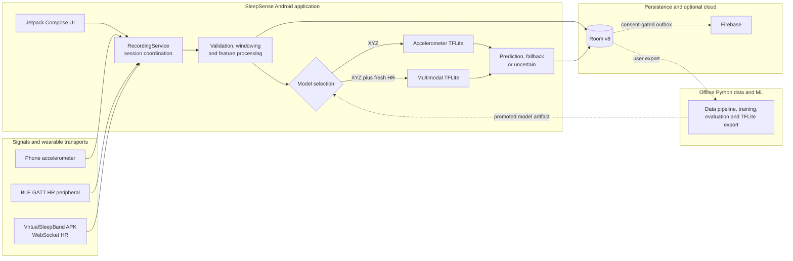
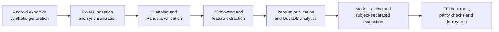

# SleepSense 2.0

SleepSense is an Android sensor platform that records nocturnal movement, integrates optional wearable heart-rate telemetry, and classifies short accelerometer windows on-device. It connects a Jetpack Compose product, BLE and virtual-device transports, local-first storage, and a reproducible Python data and ML workflow.

It classifies coarse movement states (`REST`, `RESTLESS`, `ACTIVE`), not clinical sleep stages or medical conditions.

| Main dashboard | Live recording and on-device inference |
| --- | --- |
|  |  |

## Key Capabilities

- **Sensor recording:** a foreground Android service manages accelerometer capture, pause/resume, validation, and session lifecycle.
- **On-device ML:** TensorFlow Lite models classify 20-sample XYZ windows with an accelerometer-only or HR-assisted path.
- **Wearable telemetry:** recording can use a real BLE GATT heart-rate peripheral or the separate VirtualSleepBand APK over WebSocket.
- **Local-first persistence:** Room v8 stores sessions, raw samples, feature windows, predictions, and cloud-delivery state.
- **Optional cloud sync:** a consent- and authentication-gated Firebase path uses a durable outbox and WorkManager retries.
- **Offline data and ML:** Python pipelines cover ingestion, validation, Parquet publication, DuckDB analytics, experiments, and TFLite export.

The repository builds two Android applications: `app/` is SleepSense, while `virtualsleepband/` supplies synthetic HR over WebSocket and contains a separate BLE GATT peripheral implementation. Shared Kotlin protocol source lives in `wearable-protocol/`; offline processing and training live in `pipelines/` and `ml/`, not inside either Android runtime.

## Technology Stack

| Category | Technologies |
| --- | --- |
| Android development | Kotlin, Android SDK, Jetpack Compose, Material 3, Coroutines |
| Runtime architecture | Foreground Services, ViewModel, WorkManager |
| Persistence and visualization | Room, Vico charts |
| Connectivity | Bluetooth Low Energy (GATT), Java-WebSocket |
| Cloud | Firebase Authentication, Firebase Realtime Database |
| On-device ML | LiteRT (TensorFlow Lite), dense DNN, multimodal late-fusion DNN |
| Data and ML | Python, Polars, Pandera, PyArrow/Parquet, DuckDB, scikit-learn, TensorFlow, MLflow |
| Testing and delivery | JUnit, AndroidX Test, pytest, Ruff, GitHub Actions |

## System Architecture



Android chooses either BLE GATT or WebSocket as the wearable transport; WebSocket is not Bluetooth. Room is the local source of truth, while remote delivery remains optional and can fail independently. Python training runs offline, and only verified TFLite artifacts are packaged back into an Android build.

Detailed diagrams: [system context](docs/diagrams/01-system-context.md), [Android components](docs/diagrams/02-android-components.md), [sensor and ML flow](docs/diagrams/03-data-flow.md), [Room schema](docs/diagrams/04-room-er.md), [session lifecycle](docs/diagrams/05-session-lifecycle.md), and [rules/cloud sequence](docs/diagrams/06-rules-cloud-sequence.md).

## End-to-End Data Engineering Pipeline



- Accepted and rejected records retain provenance, validation outcomes, timing discontinuities, coverage, and lineage.
- Schema validation and atomic Parquet publication make datasets reproducible and queryable without treating malformed values as valid observations.
- Shared golden vectors check Android/Python feature parity. Stored scalar features support analytics, while deployed neural models consume raw XYZ tensors.
- Training and evaluation remain offline; Android performs inference only with packaged model artifacts.

Canonical references: [data pipeline](docs/DATA_PIPELINE.md) and [Android/Python data contract](docs/datascience/ANDROID_PYTHON_DATA_CONTRACT.md).

## Machine Learning — Models and Results

The primary benchmark uses one subject-separated synthetic test set: 10,798 windows from held-out virtual subjects `SUBJ-011` and `SUBJ-012`. Training and validation use different subjects, and feature scaling is fitted only on training data.

| Model | Accuracy | Macro F1 |
| --- | ---: | ---: |
| Majority baseline | 91.86% | 0.3192 |
| Rule-based heuristic | 93.80% | 0.6345 |
| Logistic Regression | 93.78% | 0.6555 |
| Random Forest | 94.22% | **0.6857** |
| Dense accelerometer DNN | 94.38% | 0.6716 |
| 1D Temporal CNN | 94.48% | 0.6786 |
| Multimodal late-fusion DNN | **94.54%** | 0.6787 |

Accuracy alone hides minority-class failure: predicting only `REST` still reaches 91.86%, but its macro F1 is 0.3192. Macro F1 weights all three classes equally; Random Forest leads that metric in this cohort, while the multimodal DNN has the highest accuracy. Android deploys the dense accelerometer classifier and the multimodal classifier, not the benchmark Random Forest or 1D CNN.

### Domain shift

A separate shifted synthetic cohort introduces severe nightstand attenuation, increased sensor noise, altered HR physiology, and more peripheral failures. Across 53,938 windows, performance falls to **64.74% accuracy and 0.4037 macro F1**. This drop is material evidence of placement and distribution-shift sensitivity, not a secondary benchmark to combine with the subject-separated table.

Every reported cohort is synthetic. Methods and complete results: [ML experiments](docs/datascience/ML_EXPERIMENTS.md), [multimodal ablation](docs/datascience/MULTIMODAL_ABLATION.md), [domain-shift evaluation](docs/datascience/DOMAIN_SHIFT_EVALUATION.md), and [model card](docs/MODEL_CARD.md).

## On-Device ML Inference

`RecordingService` sends validated accelerometer samples and optional fresh HR to session coordination. Non-overlapping windows feed model selection; the result or fallback is then persisted with the session in Room.

| Runtime contract | Value |
| --- | --- |
| Accelerometer model | float32 XYZ `[1,20,3]` → class scores `[1,3]` |
| Multimodal model | XYZ `[1,20,3]` plus normalized HR/availability `[1,2]` → `[1,3]` |
| Default request and window | 20 Hz; 20 samples with stride 20 |
| Eligible HR | Valid and no more than 10 seconds old |
| Selection | Multimodal with eligible HR, otherwise accelerometer-only |
| Failure behavior | Rule-based fallback or `UNCERTAIN`; missing input is not silently labeled `REST` |

Android sensor delivery is best-effort rather than guaranteed at exactly 20 Hz. Model binaries in `app/src/main/assets/` are tied to tensor contracts and hashes in `ml/artifacts/deployment_manifest.json`.

## Engineering Highlights

- **Recording lifecycle:** foreground service ownership keeps capture independent of transient Compose screen state.
- **Local-first storage:** Room v8 persists raw signals, derived records, predictions, and migration history before optional remote delivery.
- **Recoverable cloud delivery:** durable outbox state and WorkManager retries separate local commits from Firebase success.
- **Explicit transport boundaries:** real BLE GATT and virtual WebSocket paths share a recording contract without presenting simulation as radio validation.
- **Data quality:** monotonic timestamps, source provenance, rejection reasons, coverage, and lineage survive export and offline processing.
- **Reproducible ML:** subject grouping, strict label eligibility, deterministic dataset generation, deployment manifests, and parity tests constrain experiments.
- **Automated verification:** Android and Python CI workflows cover builds, unit tests, pipeline checks, and model contracts within documented evidence limits.

## Product Screenshots and Demonstration

| Session history | Wearable transport selection |
| --- | --- |
|  |  |

Supported virtual demonstration flow:

1. Start the VirtualSleepBand APK and its WebSocket server.
2. Connect SleepSense using `VIRTUAL_WEBSOCKET`; on one emulator the endpoint is `ws://127.0.0.1:8765`.
3. Confirm incoming HR, start recording, and observe on-device model selection and inference.
4. Stop the session and inspect the Room-backed history entry.

Two-emulator networking requires host port forwarding. See the [virtual wearable guide](docs/VIRTUAL_WEARABLE.md).

## Quick Start

Requirements: Android Studio, Android SDK, Java 21, and Python 3.10 or newer. The Google Services plugin expects `app/google-services.json`; use a development project or the non-production CI configuration, never committed production credentials.

```bash
# Android unit tests and debug APKs
./gradlew :app:testDebugUnitTest :virtualsleepband:testDebugUnitTest
./gradlew :app:assembleDebug :virtualsleepband:assembleDebug

# Python environment and focused checks
python -m pip install -e ".[dev]"
python -m pip check
ruff check ml pipelines tests --select=E9,F63,F7,F82
python -m pytest -q tests

# Basic reproducible data workflow
python -m pipelines.cli.main generate --profile SMALL --seed 42
python -m pipelines.cli.main validate
```

Debug APKs are written to `app/build/outputs/apk/debug/app-debug.apk` and `virtualsleepband/build/outputs/apk/debug/virtualsleepband-debug.apk`. Full instructions are in [setup and verification](docs/SETUP.md).

## Limitations and Documentation

- ML training and evaluation use synthetic signals; real-world and wearable generalization are not established.
- The shifted cohort demonstrates substantial sensitivity to phone placement, noise, physiology, and peripheral failures.
- Outputs are coarse movement classes, not REM/NREM stages, medical diagnoses, or clinically calibrated probabilities.
- Emulator/WebSocket evidence does not verify physical BLE radio behavior or physical actuators.
- Local outbox and Firebase emulator coverage do not establish successful live production Firebase delivery.

Documentation: [technical index](docs/README.md), [architecture](docs/ARCHITECTURE.md), [testing scope](docs/TESTING.md), [known limitations](docs/LIMITATIONS.md), and [model card](docs/MODEL_CARD.md).
