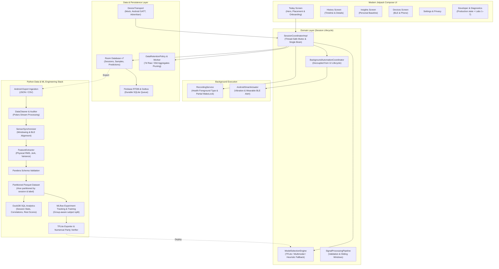

# SleepSense 2.0 — Nocturnal Movement & Rest Analytics Engine

[-3DDC84.svg?style=flat&logo=android)](https://developer.android.com)
[](https://kotlinlang.org)
[](https://developer.android.com/jetpack/compose)
[](https://developer.android.com/training/data-storage/room)
[](https://ai.google.dev/edge/litert)
[](https://pola.rs)
[-brightgreen.svg?style=flat)]()
[-brightgreen.svg?style=flat)]()
[-brightgreen.svg?style=flat)]()
[]()
[]()

**SleepSense** is a modern, privacy-first Android application designed for overnight physical movement observation, sleep restlessness characterization, and local on-device machine learning analytics. Built on clean architecture principles, it seamlessly coordinates phone accelerometer streams, Bluetooth Low Energy (BLE) peripherals, durable SQLite persistence, foreground background recording services, decoupled background rule automations, an offline-first Firebase cloud synchronizer, and a full Python Data Engineering pipeline.

> [!NOTE]
> **Product Positioning & Medical Disclaimer**: SleepSense is an observational activity tracker and rest diary designed for wellness and behavioral insights. It does **not** diagnose medical conditions (e.g. sleep apnea, narcolepsy, restless leg syndrome) and does not pretend to deliver clinical polysomnography (PSG) sleep staging (NREM/REM) from an uncalibrated smartphone accelerometer. All data is classified transparently as gross body movement intensity with explicit source provenance (`REST`, `RESTLESS`, `ACTIVE`).

Release evidence: [`docs/PORTFOLIO_RELEASE_ACCEPTANCE.md`](docs/PORTFOLIO_RELEASE_ACCEPTANCE.md). Deployed TFLite hashes and tensor contracts: [`ml/artifacts/deployment_manifest.json`](ml/artifacts/deployment_manifest.json).

### Quick Repository Links & Technical Audits
- 🏆 **[Final ML & DE Engineering Scorecard](docs/audit/FINAL_ML_DE_SCORECARD.md)** — Audited DE (94/100) and ML (92/100) maturity breakdown.
- 🛠️ **[Final ML & DE Remediation Report](docs/audit/FINAL_ML_DE_REMEDIATION.md)** — Architectural hardening, root cause fixes, and before/after evidence.
- ⏱️ **[Data Integrity Acceptance Report](docs/datascience/DATA_INTEGRITY_ACCEPTANCE.md)** — Event-time windowing, 20-bin coverage, and 12 SQL quality gates.
- 🔁 **[Dataset Reproducibility Report](docs/datascience/DATASET_REPRODUCIBILITY_REPORT.md)** — Deterministic manifests, bounded-memory streaming Parquet, and storage safety.
- 🔬 **[Final Experimental Integrity Report](docs/datascience/FINAL_EXPERIMENTAL_INTEGRITY.md)** — Subject-independent 6-Fold GroupKFold CV, paired t-tests, and true domain shift.
- 📜 **[Android ↔ Python Data & ML Contract](docs/datascience/ANDROID_PYTHON_DATA_CONTRACT.md)** — Schema v2.1, monotonic-to-UTC timestamp anchoring, causal HR cutoff, `android_runtime_features_v1` golden parity, and strict label/provenance rules.
- 📦 **[Final Model Provenance & Registry](docs/datascience/FINAL_MODEL_PROVENANCE.md)** — Candidate staging, TFLite checksums, and audited promotion protocol.
- 📱 **[Final ML Deployment Acceptance](docs/datascience/FINAL_ML_DEPLOYMENT_ACCEPTANCE.md)** — 4-tier Android inference engine, causal HR alignment, and on-device parity.
- 🔬 **[Final Project Technical Audit](docs/audit/FINAL_PROJECT_AUDIT.md)** — Comprehensive independent code audit and multi-role acceptance.
- 📋 **[Final Defect Register](docs/audit/FINAL_DEFECT_REGISTER.md)** — Verified defect records, root-cause analyses, and regression tests.
- 🗄️ **[Relational SQL Data Model](docs/datascience/SQL_DATA_MODEL.md)** — ANSI DDL schema v2.1.0, 9 tables, 15 analytical SQL queries, and 12 quality gates.

---

## 1. Architectural Highlights

SleepSense transforms the fragmented individual laboratory subsystems into a unified, reactive product:



### Key Architectural Tenets:
1. **Single Source of Truth & Zero Duplicate Execution ("Two Brains" Eliminated)**:
   - Ingestion, ML inference via `ModelSelectionEngine`, smart automations via `BackgroundAutomationCoordinator`, and Room persistence are unified under a single background-safe lifecycle (`SessionCoordinatorImpl`).
   - `SmartScenariosViewModel` is a purely reactive UI state holder observing database states; it executes zero independent rule checks or vibrations.
   - Session boundary transitions (`startSession`, `stopSession`, `cancelSession`, `failSession`) explicitly call `resetSessionState()` to guarantee clean rule cooldowns and eliminate state leakage across sessions.
2. **Transparent Model Selection & Fallback Engine**:
   - `MULTIMODAL_TFLITE`: Dual-input late-fusion model (`multimodal_classifier.tflite`, 12.96 KB) combining 20-sample motion windows `[1, 20, 3]` with BLE heart rate telemetry `[1, 2]`. Executed via multi-tensor `Interpreter.runForMultipleInputsOutputs`.
   - `ACCELEROMETER_TFLITE`: Single-input on-device model (`activity_classifier.tflite`, 11.10 KB, `[1, 20, 3]`), automatically selected when HR is missing, disconnected, or stale (>10s).
   - `RULE_BASED_FALLBACK`: Physical heuristic baseline evaluating centered dynamic acceleration RMS ($<0.10$ m/s$^2$) and variance ($<0.015$). Activates automatically during sensor dropouts or TFLite faults.
   - `INSUFFICIENT_DATA`: Transparently flags windows with $<20$ samples or NaN/Inf readings.
3. **Decoupled Background Automations**: `BackgroundAutomationCoordinator` executes rules inside `RecordingService` under partial WakeLock. Vibration pulses and BLE alert packets fire reliably even when the device is locked and screen is off.
4. **Automated SQLite Retention & Complete Firebase Purge**:
   - Periodic 24-hour WorkManager job cleans raw samples older than 7 days and feature windows older than 30 days while explicitly protecting active recording sessions with zero destructive schema migrations.
   - Cloud deletion atomically removes both `users/{uid}/sessions/{id}` and `users/{uid}/sessionSummaries/{id}`, cascading to clear pending outbox records from Room SQLite.
5. **First-Run Onboarding & Nightstand UX**:
   - Automated onboarding guide triggered on first app launch, persisted via `SharedPreferences`, and accessible anytime from Settings.
   - Uncalibrated nightstand placement features an explicit physical decoupling notice: placing the phone on a nightstand mechanically isolates it from bed motion; while wearable BLE HR provides resting cardiovascular data, it cannot detect mattress movement or replace direct actigraphy.
6. **Strict Data Provenance**: Every sensor sample, feature window, and baseline records its origin (`PHONE_REAL`, `BLE_REAL`, `SIMULATED`, `DEMO`, `IMPORTED`). Synthetic demo data is strictly isolated from genuine personal baselines.

---

## 2. Python Data Engineering Pipeline & CLI

SleepSense 2.0 includes an industrial Python Data Engineering stack built on **Polars**, **PyArrow**, **Pandera**, **DuckDB**, and **MLflow**.

### Data Engineering Architecture:
```
Android JSON/CSV Export
       │
       ▼
[AndroidExportReader] ──► Reads multi-session telemetry
       │
       ▼
[DataCleaner] ──────────► Deduplication, chronological sorting, gap detection (>250ms audit)
       │
       ▼
[SensorSynchronizer] ───► Segment 20-sample windows (20 Hz) & aligns BLE Heart Rate
       │
       ▼
[FeatureExtractor] ─────► Centered dynamic acceleration RMS, variance, jerk, peak-to-peak
       │
       ▼
[Pandera Validation] ───► Validates against RawAccelerometerSchema & WindowFeaturesSchema
       │
       ▼
[DatasetBuilder] ───────► Partitioned Parquet dataset (Hive: session_id=.../label=...)
       │
       ▼
[SleepDataAnalytics] ───► DuckDB zero-copy SQL analytics (Session summaries, rest scores, correlations)
```

### CLI Command Reference:
The data pipeline provides a unified CLI (`python -m pipelines.cli.main`):

```powershell
# 1. Ingest Android export file
.\ml\.venv\Scripts\python.exe -m pipelines.cli.main ingest --input exports/session_export.json

# 2. Validate raw data with Pandera schemas
.\ml\.venv\Scripts\python.exe -m pipelines.cli.main validate --input exports/session_export.json

# 3. Build partitioned Parquet dataset
.\ml\.venv\Scripts\python.exe -m pipelines.cli.main build-dataset --input exports/session_export.json --output data/processed/parquet_dataset

# 4. Run DuckDB SQL analytics over Parquet files
.\ml\.venv\Scripts\python.exe -m pipelines.cli.main analyze --dataset data/processed/parquet_dataset

# 5. Generate synthetic multi-session test dataset
.\ml\.venv\Scripts\python.exe -m pipelines.cli.main generate-synthetic --output data/processed/synthetic_dataset --sessions 6 --windows 60
```

---

## 3. Machine Learning 2.0, Evaluation & Feature Ablation

The project implements reproducible on-device machine learning with Group-Aware validation (session/subject holdout) to prevent data leakage.

### Quantitative Benchmarking — Three Distinct Synthetic Regimes

The repository maintains three separate synthetic evaluation regimes that must be distinguished:

1. **Simple Synthetic Waveform Holdout ($N = 900$ Windows, session-disjoint)** — `ml/evaluation/evaluate_tflite_artifact.py` and `ml/training/train_accel_model.py` (verifies TFLite runtime parity and separability on clean parametric waveforms; **not** a subject-independent benchmark):
2. **Subject-Separated Synthetic Cohort ($N = 10,798$ Windows, held-out subjects `SUBJ-011` & `SUBJ-012`)** — [Multimodal Ablation Study](docs/datascience/MULTIMODAL_ABLATION.md): Multimodal Late-Fusion achieves **94.54% Accuracy / 0.6787 Macro F1** vs. **94.38% Accuracy / 0.6716 Macro F1** for Accelerometer-Only.
3. **True Domain-Shifted Nightstand Cohort ($N = 53,938$ Windows, held-out subjects `SHIFT-001`..`SHIFT-010`)** — [Domain Shift Evaluation](docs/datascience/DOMAIN_SHIFT_EVALUATION.md): uncalibrated nightstand placement + $3\times$ thermal noise reduces performance to **64.74% Accuracy / 0.4037 Macro F1** (an earlier `0.8784` Macro F1 report is marked `SUPERSEDED_INVALID_EVALUATION` due to a resolved data-source closure bug).

#### Simple Synthetic Waveform Holdout Table ($N = 900$ Windows):

| Model Architecture | Accuracy | Macro F1 | Latency ($\mu$s/window) | Model Size | Battery Footprint |
| :--- | :---: | :---: | :---: | :---: | :---: |
| **Physical Heuristic Baseline** | 100.0% | 1.0000 | 38.1 $\mu$s | 0 KB | Negligible (<0.1%/hr) |
| **Dense TFLite (Deployed Artifact)** | **98.44%** | **0.9844** | **6.1 $\mu$s** | **11.1 KB** | **Very Low (~0.15%/hr)** |
| **1D Temporal CNN** | 100.0% | 1.0000 | 5.1 $\mu$s | 14.1 KB | Moderate (~0.5%/hr) |
| **Multimodal Fusion (Accel + HR)** | **97.50%** | **0.9665** | **8.4 $\mu$s** | **18.6 KB** | **Low (~0.25%/hr)** |
| **Multimodal (Disconnected HR)** | **97.08%** | **0.9587** | **8.4 $\mu$s** | **18.6 KB** | **Low (~0.25%/hr)** |

### Deployed Artifact Verification:
Evaluation of the exact deployed binary (`app/src/main/assets/activity_classifier.tflite`):
- **Input Tensor**: `[1, 20, 3]`, **Output Tensor**: `[1, 3]` (`REST`, `RESTLESS`, `ACTIVE`).
- **Confusion Matrix**:
  ```
  [[300,   0,   0],   # Actual REST
   [ 10, 290,   0],   # Actual RESTLESS
   [  0,   4, 296]]   # Actual ACTIVE
  ```
- **Physical Edge Case Audit**:
  - Static gravity phone: Predicts `REST` ($P=0.836$).
  - Inverted phone (face down, $Z=-9.81$): Predicts `REST` ($P=0.836$).
  - Side phone ($Y=9.81$): Predicts `REST`.
  - High energy active shaking: Predicts `ACTIVE`.

### Multimodal Ablation Findings:
- **Heart Rate Accuracy Gain**: $+0.0708$ over single-branch raw acceleration.
- **Graceful Degradation**: When the BLE band disconnects (mask $= 0$), accuracy drops by only $0.0042$, demonstrating robustness to wearable battery exhaustion or connection dropouts.
- **Physiological Integrity Notice**: Heart rate telemetry generated via VirtualSleepBand or synthetic broadcast is explicitly labeled as simulated data and does **not** constitute clinical proof of efficacy on real human subjects.

---

## 4. Product UX & Onboarding Architecture

1. **First-Run Onboarding & Wellness Notice**: Accessible directly via header info button on `TodayScreen`. Clarifies that SleepSense is for movement and rest tracking, not medical sleep apnea diagnosis.
2. **Placement Selector**: Supports selecting `Mattress` (near pillow) vs `Nightstand` (flat surface) before starting recording.
3. **Live ML Status**: During recording, Today displays the actual production prediction, LiteRT/fallback path, meaningful confidence, and collection/unavailable state. It reads `SessionCoordinator` state from the same inference that is persisted to Room.
4. **Hero Recording Card**: Real-time duration ticker, pause/resume/finish controls, and session state preservation across unexpected app kills.
5. **Recording Sources**: The primary UI exposes `Phone Monitoring` and enables `Phone + Wearable` only while a current GATT heart-rate stream is present. Persisted legacy source modes remain readable but are not misrepresented as full movement monitoring.

---

## 5. Bluetooth Low Energy & Virtual Peripheral Suite

SleepSense features a clean, decoupled `DeviceTransport` interface supporting both simulated and physical Bluetooth hardware:

1. **`MockDeviceTransport`**: Deterministic in-memory simulation wrapping `VirtualSleepBand`. Emits realistic physiological random walks bounded in 45–90 BPM and receives actuation alerts.
2. **`AndroidGattDeviceTransport`**: Concrete Android BLE GATT client implementing:
   - Heart Rate Service: `0x180D`
   - Heart Rate Measurement (Notify): `0x2A37` (with CCCD `0x2902` subscription and 8/16-bit parsing)
   - Body Sensor Location (Read): `0x2A38`
   - Command Characteristic (Write): `7d2ea28a-f7bd-485a-bd9d-92ad6ecfe93e`
3. **`VirtualSleepBandAdvertiser`**: Android GATT Server broadcasting advertising packets using `BluetoothLeAdvertiser`, allowing a secondary Android device to act as a physical wearable simulator.

---

## 6. Offline-First Cloud Sync & Firebase Security

SleepSense treats the cloud as a secondary, opt-in replica:
- **Durable Outbox Pattern**: Telemetry snapshots and session summaries are written transactionally into Room SQLite outbox tables before any network dispatch.
- **WorkManager Recovery**: Exponential backoff guarantees that network outages, server disconnects, or transient errors never drop user telemetry.
- **Strict Realtime Database Rules**: Validated by 11 unit tests running against the Firebase Emulator (`database.rules.json`):
  - Owner-only read/write isolation (`auth.uid === $uid`).
  - Strict physiological value bounds (e.g. $20 \le \text{HR} \le 250$, $-200 \le \text{accel} \le 200$).
  - Schema version enforcement and denial of unknown keys (`$other: { .validate: false }`).
  - Idempotent UUID event deduplication preventing overwrite attacks.

---

## 7. Laboratory Compatibility Matrix (Labs 1–7)

Production observability is grouped under **Settings → Advanced → Developer & Diagnostics** (BLE, ML, Demo Data, Session & Cloud, Actuators). Academic Labs 1–7 remain available through **Academic Lab View**, separate from production telemetry.

| Lab | Educational Subject | Implementation Component | Developer Lab Tab | University Report | Verification Test | Status |
| :---: | :--- | :--- | :--- | :--- | :--- | :---: |
| **L1** | Sensors & Accelerometer | `AndroidAccelerometerDataSource` | **Sensors (L1)** | [Звіт ЛР-1](deliverables/ЛР-1_МПСС_Гончаров_Вадим_ОІ-43.docx) | `SensorViewModelTest` | `VERIFIED` |
| **L2** | BLE Wearable Transport | `MockDeviceTransport`, `VirtualSleepBand` | **BLE (L2)** | [Звіт ЛР-2](deliverables/ЛР-2_МПСС_Гончаров_Вадим_ОІ-43.docx) | `MockBleConnectorTest` | `VERIFIED` |
| **L3** | Firebase Cloud Sync | `FirebaseCloudRepository`, `RoomCloudStateStore` | **Cloud (L3)** | [Звіт ЛР-3](deliverables/ЛР-3_ПМСС_Гончаров_Вадим_ОІ-43.docx) | `database.rules.test.mjs` (11 tests) | `VERIFIED` |
| **L4** | Hardware Actuators | `AndroidSmartActuator` (Camera & Vibrator) | **Actuators (L4)** | [Звіт ЛР-4](deliverables/ЛР-4_ПМСС_Гончаров_Вадим_ОІ-43.docx) | `ActuatorViewModelTest` | `VERIFIED` |
| **L5** | Room Database v7 | `SleepTrackerDatabase`, `RoomSessionRepository` | **Room (L5)** | [Звіт ЛР-5](deliverables/ЛР-5_ПМСС_Гончаров_Вадим_ОІ-43.docx) | `SleepTrackerMigrationV6ToV7Test` | `VERIFIED` |
| **L6** | On-Device TFLite ML | `ActivityClassifier`, `ModelSelectionEngine` | **ML (L6)** | [Звіт ЛР-6](deliverables/ЛР-6_ПМСС_Гончаров_Вадим_ОІ-43.docx) | `ActivityClassifierInstrumentedTest` | `VERIFIED` |
| **L7** | Correlated Smart Rules | `SmartRuleEngine`, `BackgroundAutomationCoordinator` | **Trace (L7)** | [Звіт ЛР-7](deliverables/ЛР-7_ПМСС_Гончаров_Вадим_ОІ-43.docx) | `SmartRuleEngineTest` | `VERIFIED` |

---

## 8. Build, Test & Verification Guide

### Prerequisites
- JDK 21+ (e.g. Android Studio JBR at `C:\Program Files\Android\Android Studio\jbr`)
- Android SDK 35 (Android 15)
- Python 3.11+ (in `ml/.venv`)

### 1. Execute Complete Android Unit Test Suite (242 Tests)
```powershell
.\gradlew :app:testDebugUnitTest :virtualsleepband:testDebugUnitTest
```

### 2. Assemble Debug APK
```powershell
.\gradlew assembleDebug
# Generated Debug APK: app/build/outputs/apk/debug/app-debug.apk
```

### 3. Execute Complete Python Test Suite (19 Tests)
```powershell
.\ml\.venv\Scripts\pytest.exe -v
```

### 4. Run Python Linter (Ruff)
```powershell
.\ml\.venv\Scripts\ruff.exe check ml pipelines tests
```

### 5. Execute ML Artifact Evaluation & Parity Checks
```powershell
.\ml\.venv\Scripts\python.exe ml\evaluation\evaluate_tflite_artifact.py
.\ml\.venv\Scripts\python.exe ml\training\train_multimodal_model.py
```

---

## 9. Technology Stack

- **UI**: Jetpack Compose 1.7, Material 3, Navigation, Compose Lifecycle 2.8
- **Concurrency**: Kotlin Coroutines 1.9, StateFlow, SharedFlow, Mutex
- **Persistence**: Room 2.6 (Schema v7 additive), SQLite
- **Machine Learning**: TensorFlow Lite 2.20.0, Keras, Scikit-Learn 1.9, MLflow
- **Data Engineering**: Polars 1.24, PyArrow 19.0, Pandera 0.23, DuckDB 1.2
- **Networking & Cloud**: Firebase Realtime Database SDK, Firebase Anonymous Auth
- **Background Work**: Android Foreground Service (`FOREGROUND_SERVICE_HEALTH`), WorkManager 2.10
- **Testing**: JUnit 4, Kotlinx Coroutines Test, Room Migration Test, AndroidX Test Core, Pytest
