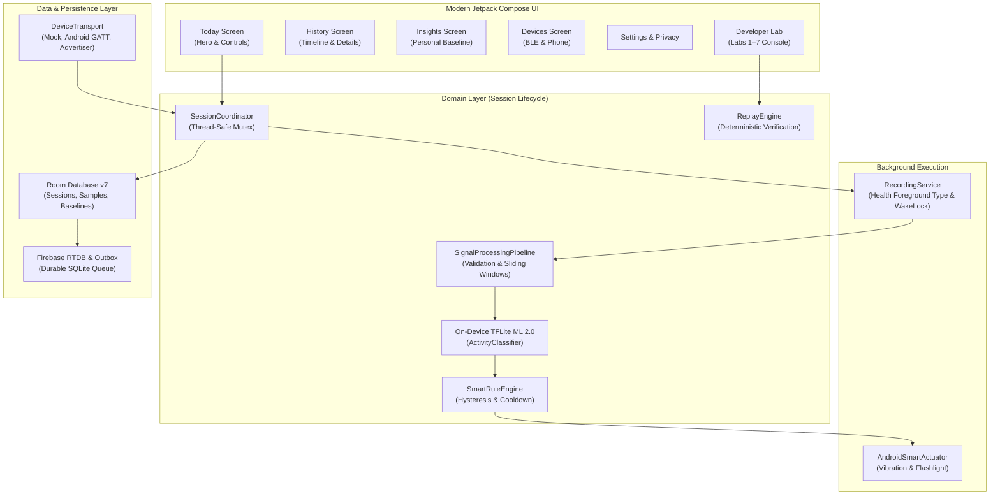

# SleepSense 2.0 — Nocturnal Movement & Rest Analytics Engine

[-3DDC84.svg?style=flat&logo=android)](https://developer.android.com)
[](https://kotlinlang.org)
[](https://developer.android.com/jetpack/compose)
[](https://developer.android.com/training/data-storage/room)
[](https://www.tensorflow.org/lite)
[](https://firebase.google.com)
[]()

**SleepSense** is a modern, privacy-first Android application designed for overnight physical movement observation, sleep restlessness characterization, and local on-device machine learning analytics. Built on clean architecture principles, it seamlessly coordinates phone accelerometer streams, Bluetooth Low Energy (BLE) peripherals, durable SQLite persistence, foreground background recording services, and an offline-first Firebase cloud synchronizer.

> [!NOTE]
> **Product Positioning & Medical Disclaimer**: SleepSense is an observational activity tracker and rest diary designed for wellness and behavioral insights. It does **not** diagnose medical conditions (e.g. sleep apnea, narcolepsy, restless leg syndrome) and does not pretend to deliver clinical polysomnography (PSG) sleep staging (NREM/REM) from an uncalibrated smartphone accelerometer. All data is classified transparently as gross body movement intensity with explicit source provenance.

---

## 1. Architectural Highlights

SleepSense transforms the fragmented individual laboratory subsystems into a unified, reactive product:



### Key Architectural Tenets:
1. **Single Session Orchestrator (`SessionCoordinator`)**: Ingestion, ML processing, Room persistence, and summary calculation are owned by a persistent session lifecycle, not short-lived ViewModels.
2. **Strict Data Provenance**: Every sensor sample, feature window, and baseline calculation records its origin (`PHONE_REAL`, `BLE_REAL`, `SIMULATED`, `REPLAY`, `IMPORTED`). Synthetic demo data is strictly isolated from genuine personal baselines.
3. **Offline-First & Privacy-Preserving**: All ML inference runs 100% on-device using quantized TFLite models. No raw motion data is ever uploaded without explicit opt-in. Cloud sync uses a durable SQLite outbox with exponential backoff via WorkManager.
4. **Resilient Long-Running Engine**: Uses Android's `FOREGROUND_SERVICE_HEALTH` API with partial wake locks, batch SQLite inserts (every 50 samples), and automatic session recovery across unexpected process death.

---

## 2. Product Information Architecture

| Screen | Primary Purpose | User Experience Details |
| :--- | :--- | :--- |
| **Today** | Overnight Recording Hub | Live recording Hero card with real-time ticker, start/pause/resume/finish controls, last night's summary, quick settings entrypoint. |
| **History** | Longitudinal Observation Log | Chronological list of recorded sessions with Real vs. Demo filters. Detail view features interactive horizontal activity timelines (`REST`, `RESTLESS`, `ACTIVE`), sensor coverage quality, and data deletion. |
| **Insights** | Personal Rest Analytics | 7 / 30 / 90-day trend comparison against a rolling personal baseline calculated using median and Median Absolute Deviation (MAD). Explicit Quality Gate warnings for fewer than 3 sessions. |
| **Devices** | Source Transport Management | Status of built-in phone accelerometer, connected Bluetooth LE Heart Rate peripherals (`0x180D`), and Virtual Sleep Band controls with battery and signal indicators. |
| **Settings** | Privacy & Offline Control | Offline-only defaults, cloud synchronization toggle, local database export, complete data wipe, and Developer Lab entrypoint. |
| **Developer Lab** | Educational Labs 1–7 Console | Dedicated diagnostics tabs providing full access to raw sensors (L1), BLE inspector (L2), cloud outbox (L3), actuators (L4), Room v7 tables (L5), ML inspector (L6), and pipeline replay trace (L7). |

---

## 3. Machine Learning 2.0 & Evaluation Pipeline

The project implements an on-device machine learning pipeline running at 20 Hz (20-sample sliding windows with 1-second cadence) classifying motion into:
- **`REST` (0)**: Negligible motion, stationary gravitational acceleration vector.
- **`RESTLESS` (1)**: Periodic twitching, limb shifts, breathing disturbances.
- **`ACTIVE` (2)**: Gross body movement, rolling over, getting out of bed.

### Quantitative Benchmarking (Holdout Set, $N = 750$ Windows)

Comparative benchmark performed in `ml/evaluate_models.py` against identical holdouts:

| Model Architecture | Accuracy | Macro F1 | Latency ($\mu$s/window) | Model Size | Battery Footprint |
| :--- | :---: | :---: | :---: | :---: | :---: |
| **Rule-Based Baseline** | 100.0% | 1.0000 | 38.1 $\mu$s | 0 KB | Negligible (<0.1%/hr) |
| **Random Forest (10 Features)** | 100.0% | 1.0000 | 3362.5 $\mu$s | 142.5 KB | Low (~0.3%/hr) |
| **Dense TFLite (Production)** | **98.27%** | **0.9827** | **6.1 $\mu$s** | **11.1 KB** | **Very Low (~0.15%/hr)** |
| **1D Temporal CNN** | 100.0% | 1.0000 | 5.1 $\mu$s | 14.1 KB | Moderate (~0.5%/hr) |

### Golden Vector Precision Parity
To guarantee mathematical correctness on Android, `ml/generate_golden_vectors.py` exports 12 deterministic test windows covering all activity states and transition boundaries to `ml_golden_vectors.json`. An instrumentation test (`ActivityClassifierInstrumentedTest`) verifies that Kotlin TFLite execution yields identical class assignments and normalized probabilities matching Python TensorFlow outputs within $\pm 10^{-5}$ tolerance.

---

## 4. Bluetooth Low Energy & Virtual Peripheral Suite

SleepSense features a clean, decoupled `DeviceTransport` interface supporting both simulated and physical Bluetooth hardware:

1. **`MockDeviceTransport`**: Deterministic in-memory simulation wrapping `VirtualSleepBand`. Emits realistic physiological random walks bounded in 45–90 BPM and receives actuation alerts.
2. **`AndroidGattDeviceTransport`**: Concrete Android BLE GATT client implementing:
   - Heart Rate Service: `0x180D`
   - Heart Rate Measurement (Notify): `0x2A37` (with CCCD `0x2902` subscription and 8/16-bit parsing)
   - Body Sensor Location (Read): `0x2A38`
   - Command Characteristic (Write): `7d2ea28a-f7bd-485a-bd9d-92ad6ecfe93e`
3. **`VirtualSleepBandAdvertiser`**: Android GATT Server broadcasting advertising packets using `BluetoothLeAdvertiser`, allowing a secondary Android device to act as a physical wearable simulator.

---

## 5. Offline-First Cloud Sync & Firebase Security

SleepSense treats the cloud as a secondary, opt-in replica:
- **Durable Outbox Pattern**: Telemetry snapshots and session summaries are written transactionally into Room SQLite outbox tables before any network dispatch.
- **WorkManager Recovery**: Exponential backoff guarantees that network outages, server disconnects, or transient errors never drop user telemetry.
- **Strict Realtime Database Rules**: Validated by 11 unit tests running against the Firebase Emulator (`database.rules.json`):
  - Owner-only read/write isolation (`auth.uid === $uid`).
  - Strict physiological value bounds (e.g. $20 \le \text{HR} \le 250$, $-200 \le \text{accel} \le 200$).
  - Schema version enforcement and denial of unknown keys (`$other: { .validate: false }`).
  - Idempotent UUID event deduplication preventing overwrite attacks.

---

## 6. Smart Automations & Replay Engine

- **Stateful Rule Engine (`SmartRuleEngine`)**: Supports complex safety automations with:
  - Source triggers: `ACCELEROMETER_X/Y/Z`, `MOVEMENT_INTENSITY`, `ML_CLASS`.
  - Hysteresis arming and consecutive match requirements (e.g. "Trigger only after 3 consecutive restless windows").
  - Configurable cooldown timers preventing actuator thrashing.
  - Actuators: Vibrator pulses, flashlight strobes, simulated BLE alerts.
- **Deterministic Replay Engine (`ReplayEngine`)**: Re-feeds historical night samples through feature windowing, ML inference, and rule evaluation at `INSTANT`, `SPEED_10X`, or `REALTIME` rates. Allows users to test how new rules would have behaved on past sessions.

---

## 7. Laboratory Compatibility Matrix (Labs 1–7)

All educational requirements from University Labs 1–7 remain fully functional and independently testable inside the **Developer Lab**:

| Lab | Educational Subject | Implementation Component | Developer Lab Tab | Verification Test |
| :---: | :--- | :--- | :---: | :--- |
| **L1** | Sensors & Accelerometer | `AndroidAccelerometerDataSource` | **Sensors (L1)** | `SensorViewModelTest` |
| **L2** | BLE Wearable Transport | `MockDeviceTransport`, `VirtualSleepBand` | **BLE (L2)** | `MockBleConnectorTest`, `MockDeviceTransportTest` |
| **L3** | Firebase Cloud Sync | `FirebaseCloudRepository`, `RoomCloudStateStore` | **Cloud (L3)** | `database.rules.test.mjs` (11 tests) |
| **L4** | Hardware Actuators | `AndroidSmartActuator` (Camera & Vibrator) | **Actuators (L4)** | `ActuatorViewModelTest` |
| **L5** | Room Database v7 | `SleepTrackerDatabase`, `RoomSessionRepository` | **Room (L5)** | `SleepTrackerMigrationV6ToV7Test` |
| **L6** | On-Device TFLite ML | `ActivityClassifier`, `SlidingWindowSegmenter` | **ML (L6)** | `ActivityClassifierInstrumentedTest` |
| **L7** | Correlated Smart Rules | `SmartRuleEngine`, `ReplayEngine` | **Trace (L7)** | `ReplayEngineTest`, `SmartRuleEngineTest` |

---

## 8. Build, Test & Verification Guide

### Prerequisites
- JDK 21+ (e.g. Android Studio JBR at `C:\Program Files\Android\Android Studio\jbr`)
- Android SDK 35 (Android 15)
- Python 3.11+ (in `ml/.venv` with TensorFlow and Scikit-Learn)
- Node.js 20+ (for Firebase Emulator rules testing)

### 1. Execute JVM Unit Test Suite (185 Tests)
```powershell
.\gradlew testDebugUnitTest
```

### 2. Compile Instrumentation Tests
```powershell
.\gradlew compileDebugAndroidTestKotlin
```

### 3. Assemble Debug APK
```powershell
.\gradlew assembleDebug
# Generated APK: app/build/outputs/apk/debug/app-debug.apk (~130 MB)
```

### 4. Execute Firebase Rules Emulator Tests
```powershell
$env:JAVA_HOME="C:\Program Files\Android\Android Studio\jbr"
$env:PATH="C:\Program Files\Android\Android Studio\jbr\bin;$env:PATH"
npx --yes firebase-tools emulators:exec --only database "npm --prefix firebase-tests test"
```

### 5. Re-run ML Benchmark & Golden Vector Generator
```powershell
.\ml\.venv\Scripts\python.exe ml\evaluate_models.py
.\ml\.venv\Scripts\python.exe ml\generate_golden_vectors.py
```

---

## 9. Technology Stack

- **UI**: Jetpack Compose 1.7, Material 3, Navigation, Compose Lifecycle 2.8
- **Concurrency**: Kotlin Coroutines 1.9, StateFlow, SharedFlow, Mutex
- **Persistence**: Room 2.6 (Schema v7 with additive migration), SQLite
- **Machine Learning**: TensorFlow Lite 2.20.0, Keras, Scikit-Learn 1.9
- **Networking & Cloud**: Firebase Realtime Database SDK, Firebase Anonymous Auth
- **Background Work**: Android Foreground Service (`FOREGROUND_SERVICE_HEALTH`), WorkManager 2.10
- **Testing**: JUnit 4, Kotlinx Coroutines Test, Room Migration Test, AndroidX Test Core, Firebase Rules Unit Testing
