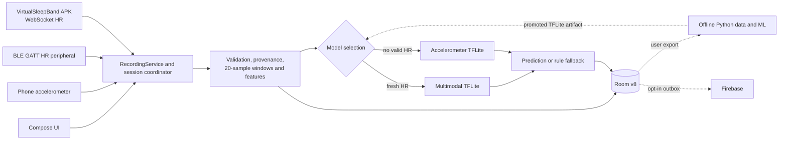
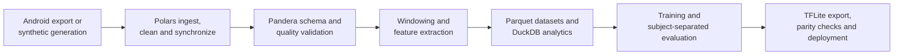
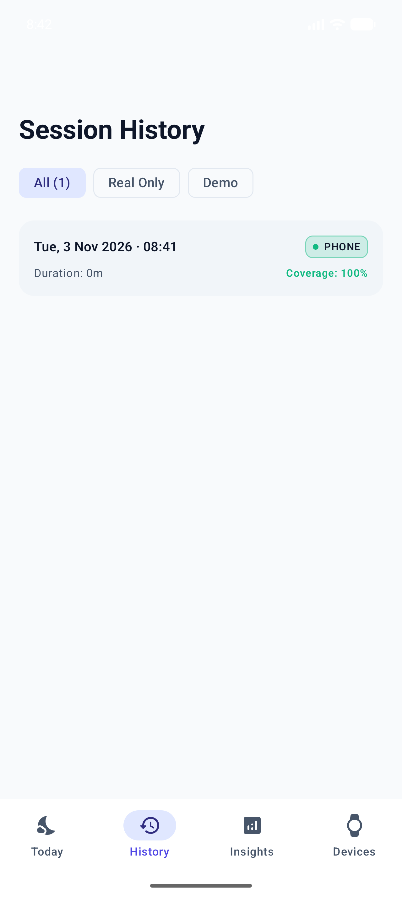

# SleepSense 2.0

SleepSense is an Android sensor platform for recording nocturnal movement, combining phone accelerometer data with optional heart-rate telemetry, and classifying short motion windows on-device. The repository also contains a separate virtual wearable application and a reproducible Python data and ML workflow.

The classifier distinguishes `REST`, `RESTLESS`, and `ACTIVE` movement. It is an engineering and synthetic-data research project, not a clinical sleep-stage or medical diagnostic system.

## Product Overview

| Capability | Implementation |
| --- | --- |
| Recording | Foreground accelerometer capture with pause/resume, session history, quality checks, and provenance |
| Wearable input | Real BLE GATT heart-rate peripherals or the independent VirtualSleepBand APK over WebSocket |
| On-device analysis | 20-sample XYZ windows, TensorFlow Lite inference, optional HR fusion, and a rule-based fallback |
| Persistence | Room v8 for sessions, sensor samples, feature windows, predictions, and durable cloud outbox state |
| Data platform | Python ingestion, Polars transformations, Pandera validation, Parquet publication, and DuckDB analytics |
| ML workflow | Synthetic-data experiments, subject-separated evaluation, TFLite export, and deployment manifests |

The repository builds two independently installable Android applications:

- `app/` — the SleepSense Jetpack Compose application, recording service, session coordinator, local database, and inference runtime.
- `virtualsleepband/` — a synthetic heart-rate source with a WebSocket server. Its BLE GATT peripheral mode represents a separate physical-device path.
- `wearable-protocol/` — shared Kotlin protocol source included in both APK source sets; it is not a standalone Gradle module.
- `pipelines/`, `ml/`, `sql/`, and `tests/` — offline data engineering, analytics, experiments, export, and regression checks.

## System Architecture



`RecordingService` receives accelerometer samples and wearable heart rate, while `SessionCoordinatorImpl` validates, windows, classifies, and persists the stream. The transport selector uses either Android BLE GATT or WebSocket; WebSocket is not Bluetooth. Cloud delivery is optional and uses a Room-backed outbox plus WorkManager recovery, consent, and authentication. A local commit does not prove remote delivery.

Detailed diagrams: [system context](docs/diagrams/01-system-context.md), [Android components](docs/diagrams/02-android-components.md), [sensor and ML flow](docs/diagrams/03-data-flow.md), [Room schema](docs/diagrams/04-room-er.md), [session lifecycle](docs/diagrams/05-session-lifecycle.md), and [rules/cloud sequence](docs/diagrams/06-rules-cloud-sequence.md).

## Data Engineering Pipeline



The offline path preserves accepted and rejected records, provenance, rejection reasons, timing discontinuities, coverage, and lineage. Cleaned model-ready tables are validated with Pandera; validated datasets are published atomically as Parquet and remain queryable through DuckDB. Supervised labels require an explicit mapping and are not inferred from runtime predictions or motion thresholds.

Android and Python feature parity is checked against shared golden vectors. Scalar analytical features support storage and offline models; the deployed neural networks consume raw XYZ tensors rather than the stored scalar feature columns. See the [data pipeline](docs/DATA_PIPELINE.md) and [Android/Python contract](docs/datascience/ANDROID_PYTHON_DATA_CONTRACT.md).

## ML Experiments and Evaluation

The primary comparison uses the same held-out subject-separated synthetic test set: 10,798 windows from `SUBJ-011` and `SUBJ-012`. Training and validation use different virtual subjects, and feature scaling is fitted on training data only. Accuracy is reported with macro F1 because the test set is heavily imbalanced toward `REST`.

| Model | Accuracy | Macro F1 |
| --- | ---: | ---: |
| Majority-class baseline | 91.86% | 0.3192 |
| Physical rule heuristic | 93.80% | 0.6345 |
| Logistic regression | 93.78% | 0.6555 |
| Random forest, 100 trees | 94.22% | **0.6857** |
| Dense accelerometer DNN | 94.38% | 0.6716 |
| 1D temporal CNN | 94.48% | 0.6786 |
| Multimodal late-fusion DNN | **94.54%** | 0.6787 |

The results show why accuracy alone is insufficient: the majority baseline reaches 91.86% while failing to detect either minority class. In this cohort, random forest has the highest macro F1, while the multimodal DNN has the highest accuracy and is the deployed HR-assisted neural path.

These figures must not be mixed with two separate regimes:

- A session-holdout waveform sanity check reports 97.22% accuracy; a different 900-window TFLite parity slice reports 98.44%. Neither is a subject-independent real-world result.
- The shifted synthetic cohort models severe placement attenuation, higher sensor noise, changed HR physiology, and more peripheral failures. Performance falls to **64.74% accuracy / 0.4037 macro F1** across 53,938 windows. This is the relevant warning about placement and distribution shift.

All cohorts are synthetic. There is no human-subject, clinical, or wearable-generalization validation. Full methods and per-class metrics are in [ML experiments](docs/datascience/ML_EXPERIMENTS.md), [multimodal ablation](docs/datascience/MULTIMODAL_ABLATION.md), [domain-shift evaluation](docs/datascience/DOMAIN_SHIFT_EVALUATION.md), and the [model card](docs/MODEL_CARD.md).

## On-Device ML Runtime

| Runtime contract | Value |
| --- | --- |
| Accelerometer model | float32 `[1,20,3]` XYZ → `[1,3]` |
| Multimodal model | XYZ `[1,20,3]` plus normalized HR/availability `[1,2]` → `[1,3]` |
| Default sampling request | 20 Hz; Android delivery remains best-effort |
| Segmentation | 20 samples, stride 20; nominal one-second non-overlapping windows |
| Eligible HR | Valid and no more than 10 seconds old |
| Selection order | Multimodal when HR is eligible, then accelerometer-only, then documented fallback or `UNCERTAIN` |

The TFLite binaries in `app/src/main/assets/` are tied to hashes and tensor contracts in `ml/artifacts/deployment_manifest.json`. Runtime input checks reject incomplete or non-finite tensors; missing data is not silently classified as `REST`. HR preprocessing uses `(bpm - 60) / 40` plus an explicit availability flag.

## Engineering Highlights

- Layered Android design built around Compose state, a foreground recording service, explicit session coordination, repositories, and Room v8 migrations.
- Distinct real BLE and virtual WebSocket transports behind one recording interface, without presenting WebSocket simulation as RF validation.
- Monotonic sensor timestamps, source provenance, validation outcomes, and quality metadata retained through Android export and offline processing.
- Durable opt-in cloud outbox with retry state instead of treating local persistence as proof of Firebase delivery.
- Leakage-aware subject grouping, strict label eligibility, deployment manifests, golden-vector parity checks, and TFLite artifact validation.
- CI workflows for Android and Python/data-science checks, with evidence boundaries documented separately from physical-device acceptance.

## Screenshots and Demonstration

| Today and session control | Live recording and ML state |
| --- | --- |
|  |  |

| Session history | Device transport selection |
| --- | --- |
|  |  |

Virtual wearable demonstration:

1. Install and start the VirtualSleepBand APK.
2. Start its WebSocket server.
3. In SleepSense, select `VIRTUAL_WEBSOCKET` and connect to `ws://127.0.0.1:8765` when both apps run on the same emulator.
4. Start a recording and confirm HR freshness and model selection in the live recording screen.

Two-emulator networking requires host port forwarding. See the [virtual wearable guide](docs/VIRTUAL_WEARABLE.md).

## Quick Start, Verification and Limitations

Requirements: Android Studio, Android SDK, Java 21, and Python 3.10 or newer. Firebase builds require `app/google-services.json`; CI uses a non-production dummy configuration that does not enable live Firebase access.

```bash
# Android unit tests and debug APKs
./gradlew :app:testDebugUnitTest :virtualsleepband:testDebugUnitTest
./gradlew :app:assembleDebug :virtualsleepband:assembleDebug

# Python environment and focused CI-equivalent checks
python -m pip install -e ".[dev]"
python -m pip check
ruff check ml pipelines tests --select=E9,F63,F7,F82
python -m pytest -q tests

# Reproducible small synthetic dataset
python -m pipelines.cli.main generate --profile SMALL --seed 42
python -m pipelines.cli.main validate
```

Debug APKs are written to `app/build/outputs/apk/debug/app-debug.apk` and `virtualsleepband/build/outputs/apk/debug/virtualsleepband-debug.apk`. Detailed setup and test scope are documented in [setup](docs/SETUP.md) and [testing](docs/TESTING.md).

Current evidence does not establish clinical validity, real-world accuracy, physical BLE radio performance, physical actuator behavior, or live production Firebase delivery. Phone placement can decouple accelerometer measurements from body movement, confidence scores are not clinically calibrated probabilities, and Android sensor timing is not guaranteed to be exactly 20 Hz. See [known limitations](docs/LIMITATIONS.md).
