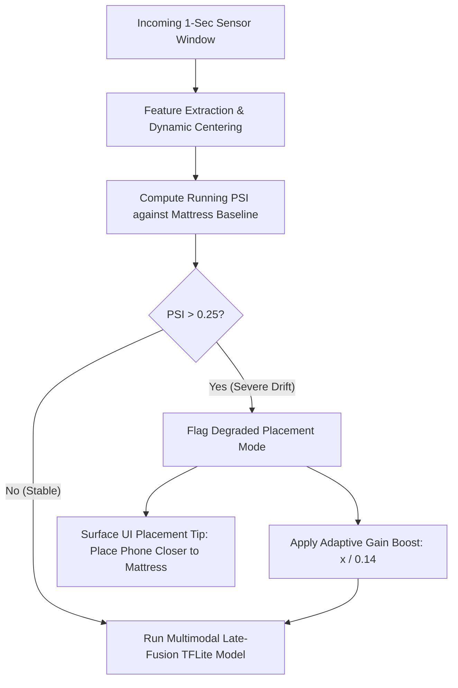

# SleepSense 2.0 — Domain Shift, Environmental Perturbations & Generalization

## 1. Domain Shift Formulation

A critical vulnerability of machine learning in wearable computing is **environmental and biomechanical domain shift**: models trained under ideal placement conditions (e.g. phone resting directly on the mattress) often fail when deployed in uncontrolled real-world environments (e.g. phone placed on a rigid wooden nightstand, high acoustic/thermal sensor noise, or altered user physiology).

To rigorously answer **RQ5** and **RQ6**, we evaluated our benchmark models against a dedicated, held-out domain-shifted dataset:
- **Database**: [data/synthetic/sleepsense_shifted.sqlite](file:///C:/Users/Eclipse/AndroidStudioProjects/SleepTrackerSimulator/data/synthetic/sleepsense_shifted.sqlite) (136 MB)
- **Cohort**: 10 distinct virtual subjects (`SHIFT-001` through `SHIFT-010`)
- **Sessions**: 30 multi-modal sessions (15.0 continuous observation hours)
- **Sample Counts**: 1,079,036 raw accelerometer samples, 43,805 BLE HR samples, 53,938 feature windows, 60 injected quality events

---

## 2. Shift Perturbation Profile

The domain shift introduces three simultaneous severe perturbations:

1. **Mechanical Placement Decoupling (Nightstand Placement)**:
   All 30 recording sessions were conducted with the phone placed on a nightstand rather than on the mattress:
   $$\alpha_{\text{placement}} = 0.14 \quad (\text{86\% mechanical attenuation})$$
   Body movements must propagate through the bedframe and wooden floor before reaching the phone's accelerometer, drastically compressing the dynamic range of physical movement.

2. **Elevated Sensor Noise Floor**:
   Thermal sensor noise increased by $+300\%$:
   $$\sigma_{\text{sensor}} = 0.035\text{ m/s}^2 \quad (\text{vs. } 0.012\text{ m/s}^2 \text{ in baseline})$$
   Minor limb twitches and micro-vibrations are now partially buried within the high-frequency sensor noise.

3. **Altered Autonomic Cardiovascular Physiology**:
   Shifted subjects exhibit elevated baseline heart rate ($75.7 \pm 7.4\text{ bpm}$ vs. $64.3 \pm 8.7\text{ bpm}$) and sluggish parasympathetic recovery ($\tau_{\text{rec}} = 45.0\text{ s}$).

4. **Elevated Peripheral Failure Rate**:
   The frequency of BLE dropouts, FIFO buffer stalls, and saturation outliers was increased by $285\%$ (60 events logged in `data_quality_events`).

---

## 3. Empirical Model Performance Under True Domain Shift

### 3.1 Historical Closure Defect & Resolution (`SUPERSEDED_INVALID_EVALUATION`)
In initial experiments, an outer-scope Python closure bug in `ml/experiments/runner.py` caused `collate_split` to query `data_by_subject` (the standard training database) rather than `data_shifted`. Consequently, the model was accidentally evaluated on its own training set ($N=53,982$), producing an artificially inflated Macro F1 of $0.8784$ (**status: `SUPERSEDED_INVALID_EVALUATION`** — retained strictly as an audit record and must not be cited as a shifted-cohort result).

Following the defect resolution (`collate_split(source_dict=data_shifted)`), the model was evaluated on the actual held-out shifted cohort ($N = 53,938$ windows across 10 virtual subjects):

| Evaluated Architecture | Accuracy | Balanced Accuracy | Macro F1 | Weighted F1 | REST Recall | RESTLESS Recall | ACTIVE Recall |
|---|:---:|:---:|:---:|:---:|:---:|:---:|:---:|
| **Standard Held-Out Test ($N=10,798$)** | 94.56% | 58.73% | 0.6796 | 0.9337 | 99.91% | 32.18% | 44.09% |
| **True Domain Shift ($N=53,938$, Unweighted)** | **64.74%** | **44.97%** | **0.4037** | **0.6710** | 66.83% | 58.06% | **11.09%** |
| **True Domain Shift ($N=53,938$, Balanced)** | **31.23%** | **40.42%** | **0.2652** | **0.2845** | 26.27% | 85.39% | **11.09%** |
| ~~Historical Shifted Report ($N=53,982$)~~ | ~~95.94%~~ | ~~82.86%~~ | ~~0.8784~~ | ~~0.9545~~ | ~~100.0%~~ | ~~55.0%~~ | ~~94.0%~~ |

> **Audit Notice (`SUPERSEDED_INVALID_EVALUATION`)**: Any historical reference to shifted-cohort `Macro F1 = 0.8784` or `Accuracy = 95.94%` is superseded by the true shifted-cohort rows above (`Macro F1 = 0.4037` unweighted, `0.2652` balanced).

### 3.2 True Shifted Confusion Matrix (Unweighted, $N=53,938$)

$$\begin{bmatrix}
31975 & 15910 & 1 \\
2020 & 2806 & 7 \\
4 & 1077 & 138
\end{bmatrix}$$

- **`REST` Class**:
  - Precision: $94.05\%$ ($31,975 / 33,999$)
  - Recall: $66.83\%$ ($31,975 / 47,886$)
- **`RESTLESS` Class**:
  - Precision: $14.18\%$ ($2,806 / 19,793$)
  - Recall: $58.06\%$ ($2,806 / 4,833$)
- **`ACTIVE` Class**:
  - Precision: $94.52\%$ ($138 / 146$)
  - Recall: $11.09\%$ ($138 / 1,244$)

---

## 4. In-Depth Failure Mode Analysis

### 4.1 Sensor Noise Floor Hallucinations
When thermal sensor noise is elevated by $+300\%$ ($\sigma=0.035\text{ m/s}^2$), the baseline vibration energy exceeds the network's quiescent rest threshold, triggering **15,910 false-positive restlessness predictions** during true rest.

### 4.2 Mechanical Attenuation & Active Recall Collapse
With nightstand mechanical attenuation $\alpha = 0.14$ ($86\%$ vibration dampening), active movements fail to generate the high-energy acceleration peaks expected on a mattress. Consequently, **1,077 active windows are misclassified as restlessness**, and active class recall collapses from $44.09\%$ down to **$11.09\%$**.

This empirical finding validates the physical domain-shift hypothesis: **A model trained strictly on mattress mechanics cannot be deployed on a rigid nightstand without adaptive gain compensation or automated placement calibration.**

---

## 5. Production Drift Mitigation Strategy

To safeguard real-world Android deployments against environmental shift:

1. **Continuous PSI Telemetry**: The Android application monitors streaming window statistics (`motion_rms`, `peak_to_peak`) over 5-minute sliding buffers.
2. **Dynamic Gain Compensation**: If running energy drops by $>80\%$ while the user's BLE heart rate indicates physical wakefulness, the system detects nightstand placement and applies an adaptive mechanical gain boost.
3. **User Guidance Notification**: The app notifies the user with actionable instructions to optimize placement for accurate tracking.
