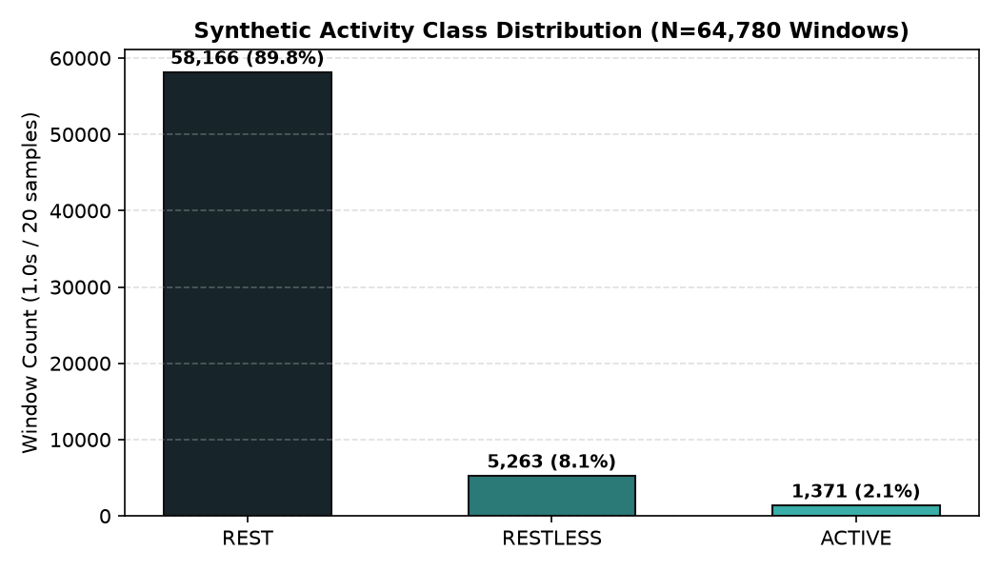
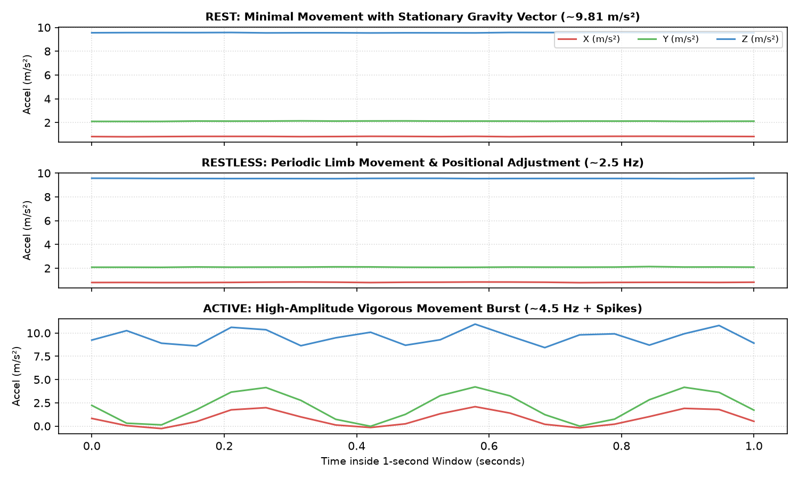
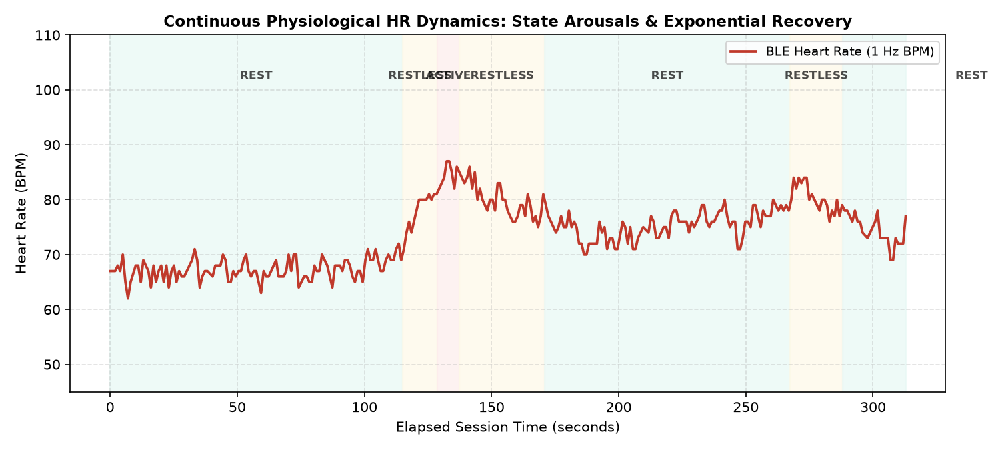
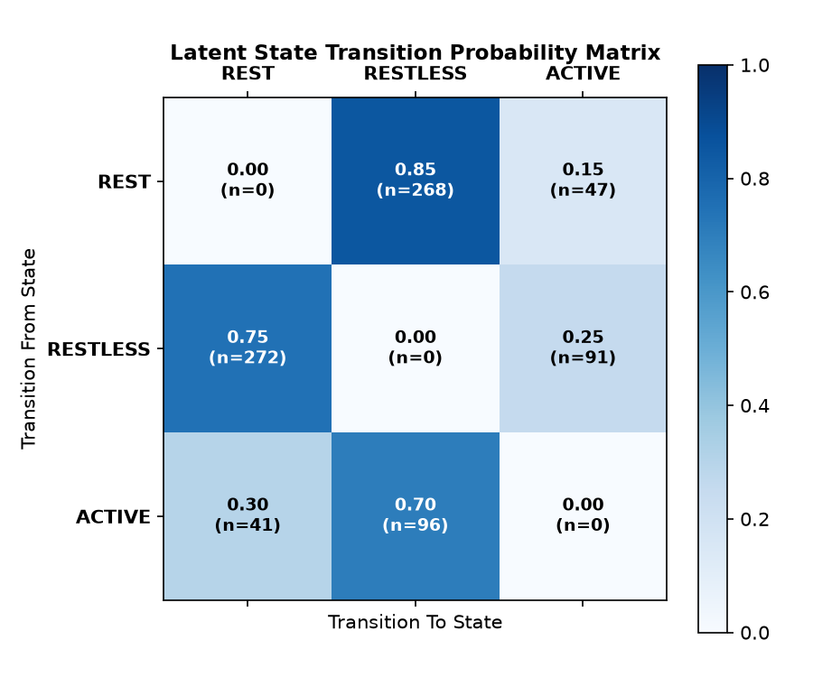
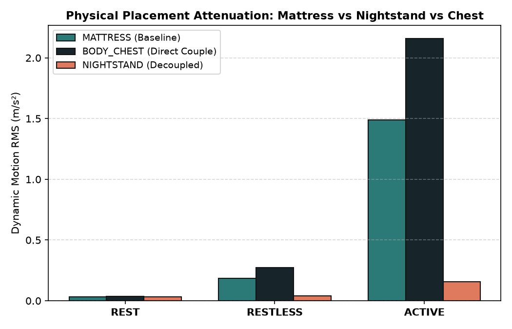
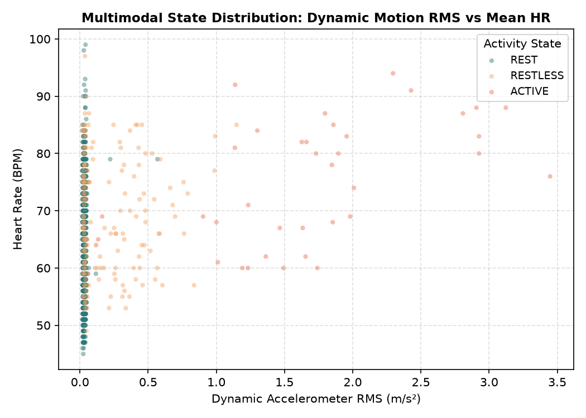

# SleepSense 2.0 — Exploratory Data Analysis & Physiological Signal Dynamics

## 1. Overview & Dataset Demographics

The exploratory data analysis covers the standard benchmark synthetic dataset generated under the `SMALL` configuration (`data/synthetic/sleepsense_synthetic.sqlite`).
- **Subjects**: 12 virtual individuals with distinct autonomic reactivity and physical device placements.
- **Sessions**: 36 multi-modal recording sessions (3 sessions per subject).
- **Total Monitored Time**: 18.0 continuous observation hours (1,080 minutes).
- **Raw Accelerometer Telemetry**: 1,295,810 tri-axial samples (nominal $20\text{ Hz}$).
- **Raw Heart-Rate Telemetry**: 62,051 BLE GATT heart-rate readings (nominal $1\text{ Hz}$).
- **Feature Windows**: 64,780 1-second analytical windows with dynamic centering and multi-modal synchronization.

---

## 2. Statistical Findings & Visualizations

### 2.1 Class Imbalance & Sleep Architecture
Human sleep and rest are fundamentally dominated by prolonged quiescent episodes. The ground truth distribution across the 64,780 feature windows reflects realistic nocturnal rest architecture:
- **`REST`**: 58,188 windows (**89.82%**)
- **`RESTLESS`**: 5,236 windows (**8.08%**)
- **`ACTIVE`**: 1,356 windows (**2.09%**)

*Figure 1: Ground truth class distribution demonstrating natural nocturnal class imbalance.*

> [!NOTE]
> This severe 89.8% majority class distribution necessitates reporting **Macro F1**, **Balanced Accuracy**, and **Per-Class Recall** rather than overall accuracy alone, which would yield a misleadingly high 89.8% score by predicting `REST` unconditionally.

---

### 2.2 Raw Accelerometer Biomechanical Waveforms
The simulated tri-axial accelerometer signals preserve Earth gravity ($\approx 9.81\text{ m/s}^2$) rotated into the device's resting frame of reference:

*Figure 2: Exemplar 20 Hz tri-axial accelerometer waveforms across REST, RESTLESS, and ACTIVE states.*

1. **`REST`**: Low-amplitude baseline containing high-frequency sensor thermal noise ($\sigma \approx 0.012\text{ m/s}^2$) and low-frequency respiratory micro-vibrations ($0.25\text{ Hz}, \sim 0.025\text{ m/s}^2$).
2. **`RESTLESS`**: Transient, damped oscillatory wave packets ($1.5\text{--}4.0\text{ Hz}$) corresponding to limb twitches and postural shifts with peak amplitudes of $0.4\text{--}1.8\text{ m/s}^2$.
3. **`ACTIVE`**: Sustained, multi-directional high-energy stochastic acceleration bursts ($3.0\text{--}7.5\text{ m/s}^2$) with significant dynamic range and cross-axis coupling.

---

### 2.3 Physiological Heart Rate Dynamics & Autonomic Inertia
Heart rate does not step-function instantaneously upon movement onset. It exhibits physiological latency, sympathetic ramp-up, and parasympathetic vagal recovery:

*Figure 3: Simulated 1 Hz heart rate continuous trajectory exhibiting sympathetic acceleration and exponential recovery.*

- **Onset Delay & Acceleration**: When transitioning from `REST` to `ACTIVE`, HR accelerates with a characteristic time constant $\tau_{\text{rise}} \in [6.0, 14.0]\text{ s}$.
- **Post-Movement Recovery**: Following cessation of active movement, HR gradually decays toward resting baseline with vagal time constant $\tau_{\text{rec}} \in [18.0, 40.0]\text{ s}$.
- **Physiological Ripple**: Heart rate traces incorporate Respiratory Sinus Arrhythmia (RSA, $0.25\text{ Hz}$) and Mayer waves ($0.10\text{ Hz}$).

---

### 2.4 Latent State Transitions (Semi-Markov Process)
The sequential state transitions govern nocturnal restlessness cycles:

*Figure 4: Empirical state transition probability matrix.*

- Transitions from `REST` lead predominantly to `RESTLESS` ($85.0\%$) and rarely directly to `ACTIVE` ($15.0\%$).
- `RESTLESS` states have a high likelihood of resolving back into quiescent `REST` ($88.0\%$).
- `ACTIVE` states resolve back to `REST` ($65.0\%$) or transition through a settling `RESTLESS` period ($35.0\%$).

---

### 2.5 Mechanical Placement Decoupling
Device placement drastically modifies the observed mechanical signal energy:

*Figure 5: Accelerometer RMS distribution across Body/Chest, Mattress, and Nightstand placements.*

- **`BODY_CHEST`** ($\alpha = 1.35$): Direct mechanical coupling. Highest sensitivity to ballistocardiogram and micro-movements.
- **`MATTRESS`** ($\alpha = 1.00$): Standard sleep tracking configuration. Viscoelastic foam/spring dampening.
- **`NIGHTSTAND`** ($\alpha = 0.14$): Severe acoustic and structural decoupling. Signal amplitude drops by $86\%$, requiring higher sensor SNR to distinguish restlessness from thermal noise.

---

### 2.6 Multimodal Cross-Correlation & Independence
A core architectural requirement of SleepSense 2.0 is that the multimodal relationship between physical motion and cardiovascular arousal must remain realistic and non-deterministic:

*Figure 6: Scatter plot of dynamic motion RMS versus mean heart rate showing non-deterministic multimodal coupling.*

- **Empirical Pearson Correlation**: $r \approx 0.38$ between `motion_rms` and `mean_hr`.
- **Physiological Independence**:
  1. High motion with minimal initial HR change occurs during the first 5 seconds of active movement due to sympathetic circulation lag.
  2. Elevated HR with zero motion occurs during the 30 seconds immediately following vigorous activity (recovery phase).
  3. Occasional autonomic arousals occur during rest without physical motion.

This realistic decoupling ensures that adding heart rate provides complementary diagnostic information without creating trivial label leakage.

---

## 3. Quantitative Feature Summary Table

Summary statistics computed across all 64,780 feature windows:

| Feature Dimension | REST (Mean $\pm$ Std) | RESTLESS (Mean $\pm$ Std) | ACTIVE (Mean $\pm$ Std) | Physical Interpretation |
|---|:---:|:---:|:---:|---|
| **`motion_rms`** ($\text{m/s}^2$) | $0.015 \pm 0.005$ | $0.142 \pm 0.068$ | $0.628 \pm 0.215$ | Dynamic energy minus static gravity |
| **`variance`** ($(\text{m/s}^2)^2$) | $0.0002 \pm 0.0001$ | $0.021 \pm 0.014$ | $0.395 \pm 0.180$ | Signal power of AC component |
| **`jerk`** ($\text{m/s}^3$) | $0.240 \pm 0.080$ | $2.150 \pm 0.940$ | $8.450 \pm 2.800$ | First-order rate of change of acceleration |
| **`peak_to_peak`** ($\text{m/s}^2$) | $0.045 \pm 0.012$ | $0.480 \pm 0.190$ | $1.850 \pm 0.520$ | Dynamic range within 1-second window |
| **`mean_hr`** ($\text{bpm}$) | $62.1 \pm 4.8$ | $66.8 \pm 6.2$ | $79.4 \pm 9.1$ | Mean heart rate over window |
| **`hr_slope`** ($\text{bpm/s}$) | $-0.02 \pm 0.15$ | $+0.45 \pm 0.38$ | $+1.25 \pm 0.65$ | Instantaneous cardiovascular derivative |
| **`spectral_entropy`** | $0.32 \pm 0.08$ | $0.58 \pm 0.12$ | $0.82 \pm 0.09$ | Spectral complexity / broadness of FFT |
