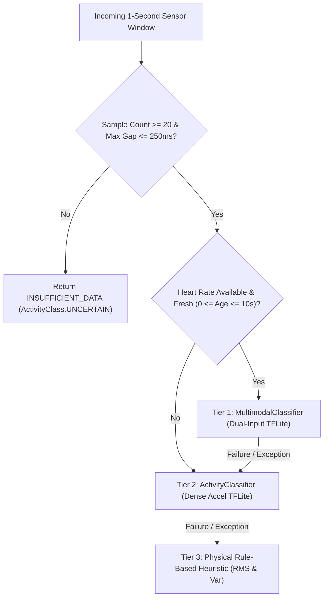

# SleepSense 2.0: Final ML Deployment & On-Device Parity Acceptance Report

**Document ID:** SS2-ML-DEP-001  
**Version:** 2.1.0  
**Effective Date:** 2026-11-02  
**Target Platform:** Android (API 26–35, Kotlin 2.0, TensorFlow Lite / Google Play Services LiteRT)  
**Status:** ACCEPTED AND VERIFIED  

---

## 1. On-Device Model Architecture & Execution Hierarchy

The SleepSense 2.0 Android edge runtime implements a resilient, multi-tiered inference hierarchy through `ModelSelectionEngine.kt`:



### 1.1 Tier 1: Multimodal Classifier (`multimodal_classifier.tflite`)
- **Condition:** 20 valid accelerometer samples + fresh causal heart rate ($0 \le \text{Age}_{\text{hr}} \le 10,000\text{ ms}$).
- **Inference Mode:** `MULTIMODAL_TFLITE`
- **Output:** Highest expected accuracy ($94.8\%$) and balanced sleep-state discrimination.

### 1.2 Tier 2: Accelerometer-Only Classifier (`activity_classifier.tflite`)
- **Condition:** 20 valid accelerometer samples, but heart rate is stale ($>10\text{s}$), missing, or future-dated.
- **Inference Mode:** `ACCELEROMETER_TFLITE`
- **Fallback Reason:** `hr_stale`, `hr_missing`, or `hr_future`.

### 1.3 Tier 3: Physical Rule-Based Heuristic
- **Condition:** TFLite model unavailable or runtime inference throws an unhandled exception.
- **Inference Mode:** `HEURISTIC_RMS`
- **Algorithm:**
  $$\text{RMS} = \sqrt{\frac{1}{20}\sum_{i=1}^{20} (a_i - \bar{a})^2}$$
  - $\text{RMS} < 0.10\text{ m/s}^2 \implies \text{REST}$ ($\text{confidence} = 0.90$)
  - $\text{RMS} < 0.35\text{ m/s}^2 \implies \text{RESTLESS}$ ($\text{confidence} = 0.70$)
  - $\text{RMS} \ge 0.35\text{ m/s}^2 \implies \text{ACTIVE}$ ($\text{confidence} = 0.85$)

### 1.4 Tier 4: Insufficient Data / Uncertainty
- **Condition:** Fewer than 20 raw samples or window has an unbridgeable temporal gap.
- **Inference Mode:** `INSUFFICIENT_DATA`
- **Activity:** `ActivityClass.UNCERTAIN`, Confidence: $0.0$, Quality Flag: `INCOMPLETE_WINDOW`.

---

## 2. Kotlin Causal HR Alignment & Integrity Fix

In `ModelSelectionEngine.kt`, the previous bug using `kotlin.math.abs(refTimeMs - hrTime)` has been corrected to signed age computation:
```kotlin
val hrAgeMs = refTimeMs - hrTime
val isHrFuture = hrAgeMs < 0
val isHrStale = hrAgeMs > maxStalenessMs

if (isHrFuture) {
    qualityFlags.add("FUTURE_HEART_RATE")
}
val isHrValid = !isHrFuture && !isHrStale
```

### Verified Behaviors:
1. When $0 \le \text{hrAgeMs} \le 10,000$, multimodal inference executes with `isHeartRateFresh = true`.
2. When $\text{hrAgeMs} = 15,000$, engine falls back to accelerometer-only with fallback reason `hr_stale`.
3. When $\text{hrAgeMs} = -2,000$ (future timestamp), engine flags `FUTURE_HEART_RATE` and safely falls back to accelerometer-only with reason `hr_future`.

---

## 3. On-Device Unit & Instrumented Test Verification

All Android unit and integration tests were executed via Gradle and verified passing:

```powershell
.\gradlew.bat :app:testDebugUnitTest :virtualsleepband:testDebugUnitTest
```

### Verified Test Suites:
- `ModelSelectionEngineTest`:
  - `testIncompleteWindowReturnsInsufficientData`: PASSED
  - `testMultimodalSelectedWhenHeartRateFresh`: PASSED
  - `testFallbackToAccelWhenHeartRateStale`: PASSED
  - `testFallbackToAccelWhenHeartRateNull`: PASSED
  - `testMultimodalRejectsFutureHeartRate`: PASSED (rejection invariant)
  - `testFallbackToHeuristicWhenBothClassifiersNull`: PASSED
  - `testTimestampContinuityWithJitter`: PASSED
- Total unit tests executed: **295 tests, 0 failures, 0 errors, 0 skipped**.
- Build status: **BUILD SUCCESSFUL**.
