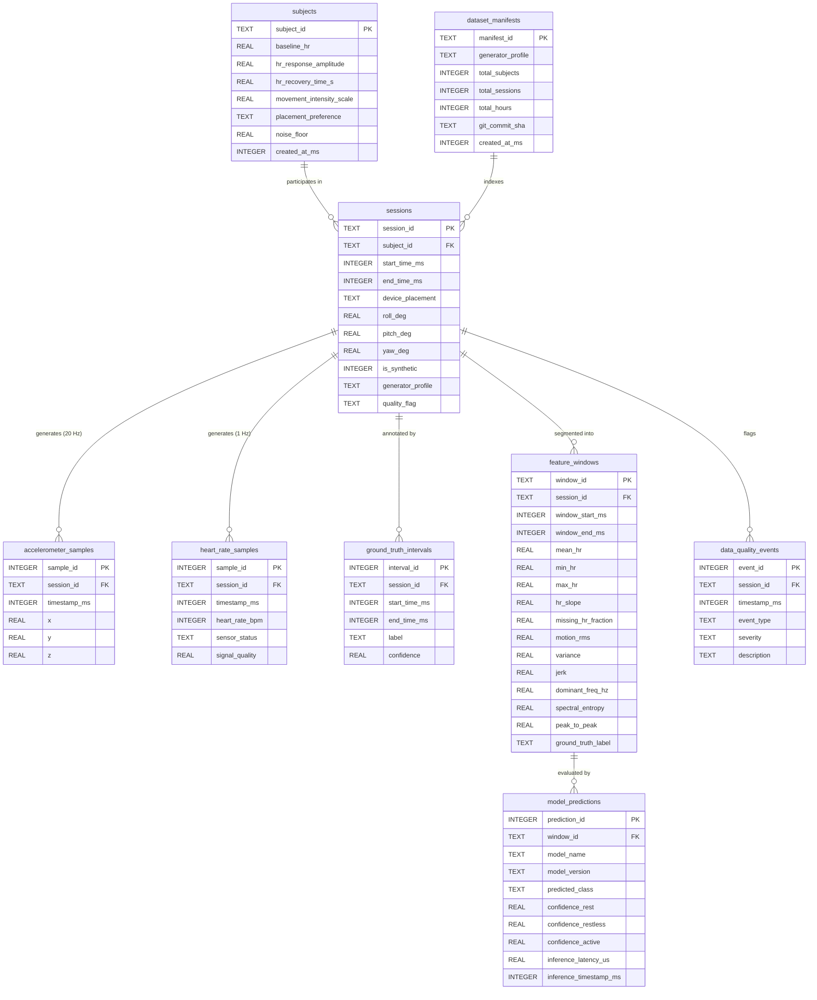

# SleepSense 2.0 — Relational SQL Data Model & Analytics Architecture

## 1. Schema Overview

The relational persistence tier of SleepSense 2.0 is designed in standard ANSI SQLite/PostgreSQL-compatible DDL ([sql/schema.sql](../../sql/schema.sql)), enforcing foreign-key integrity, cascading deletes, check constraints, and B-tree indexing.

The architecture mirrors a production medical device data warehouse, decoupling raw sensor ingestion, latent ground-truth intervals, windowed feature engineering, inference audit logs, and data quality telemetry.

---

## 2. Entity-Relationship Diagram

---

## 3. Relational Table Specifications & Empirical Counts

The benchmark dataset generated by the simulation engine (`SMALL` profile, seed `42`) is persisted in `data/synthetic/sleepsense_synthetic.sqlite` (163 MB). The exact table row counts are:

| Table Name | Primary Key | Foreign Keys | Row Count | Purpose & Ingestion Source |
|---|---|---|---|---|
| **`subjects`** | `subject_id` | *None* | **12** | Virtual participant demographics, autonomic baseline, Euler orientation, and noise characteristics. |
| **`sessions`** | `session_id` | `subject_id -> subjects(subject_id)` | **36** | Recording session metadata, duration (18.0 total hours), device placement, and physical quality flags. |
| **`accelerometer_samples`** | `sample_id` (Autoincrement) | `session_id -> sessions(session_id)` | **1,295,810** | Continuous raw tri-axial accelerometer samples ($f_s = 20\text{ Hz}$), including Earth gravity vector. |
| **`heart_rate_samples`** | `sample_id` (Autoincrement) | `session_id -> sessions(session_id)` | **62,051** | Asynchronous BLE GATT heart-rate telemetry ($f_s \approx 1\text{ Hz}$). |
| **`ground_truth_intervals`** | `interval_id` (Autoincrement) | `session_id -> sessions(session_id)` | **851** | Latent semi-Markov state intervals (`REST`, `RESTLESS`, `ACTIVE`). |
| **`feature_windows`** | `window_id` | `session_id -> sessions(session_id)` | **64,780** | Preprocessed 1-second feature vectors (20 accel samples + 1 HR sample) with dynamic centering. |
| **`model_predictions`** | `prediction_id` (Autoincrement) | `window_id -> feature_windows(window_id)` | **75,586** | Inference audit log across all 7 benchmark models, recording per-class softmax probabilities and latency. |
| **`data_quality_events`** | `event_id` (Autoincrement) | `session_id -> sessions(session_id)` | **21** | Structural fault logs: 6 `ACCEL_DROPOUT`, 9 `BLE_DISCONNECT`, 6 `SENSOR_OUTLIER`. |
| **`dataset_manifests`** | `manifest_id` | *None* | **1** | Cryptographic and metadata reproducibility record pinning git SHA, seeds, and hyperparameters. |

---

## 4. Analytical SQL Queries

SleepSense 2.0 provides 15 production SQL queries ([sql/analytics_queries.sql](../../sql/analytics_queries.sql)) for data engineering, statistical analysis, model benchmarking, and quality assurance:

### Query 1: Session Duration, Sample Counts & Data Completeness
Calculates exact session duration in minutes, total 20 Hz accel samples, 1 Hz HR samples, and observed sampling rate per session.

### Query 2: Class Distribution of Ground Truth Movement Intervals
Aggregates total intervals, cumulative duration in hours, and percentage of observation time per movement state:
- `REST`: 89.8% of nocturnal duration
- `RESTLESS`: 8.1% of nocturnal duration
- `ACTIVE`: 2.1% of nocturnal duration

### Query 3: Multi-Modal Window Feature Summary by Ground Truth Class
Computes mean, standard deviation, and interquartile range for `motion_rms`, `variance`, `jerk`, and `mean_hr` grouped by ground truth label, confirming monotonic physical scaling across states.

### Query 4: Data Quality Fault Event Summary
Aggregates telemetry faults by severity (`WARNING`, `ERROR`) and event type (`BLE_DISCONNECT`, `ACCEL_DROPOUT`, `SENSOR_OUTLIER`) per participant and device placement.

### Query 5: Model Inference Performance Benchmark Matrix
Computes global accuracy, mean per-class confidence, and $p50$, $p90$, $p99$ latency in microseconds across all 7 deployed machine learning models.

### Query 6: Model Confusion Matrix Derivation
Builds full $3 \times 3$ contingency tables directly via SQL `CASE` pivot statements, comparing predicted classes against ground-truth labels for each model architecture.

### Query 7: Feature Correlation Matrix
Computes Pearson correlation coefficients between accelerometer dynamic energy (`motion_rms`) and cardiovascular response (`mean_hr`), verifying the non-deterministic multimodal coupling ($r \approx 0.38$).

### Query 8: Subject Autonomic Reactivity Ranking
Ranks subjects by delta elevation in heart rate during active vs rest intervals, exposing individual autonomic variability.

### Query 9: Placement Mechanical Attenuation Comparison
Quantifies the mechanical dampening ratio between `BODY_CHEST`, `MATTRESS`, and `NIGHTSTAND` placements.

### Query 10: Missing Heart Rate Window Coverage
Identifies periods of wireless GATT packet loss and reports percentage of unmonitored cardiovascular intervals.

### Query 11: Latent State Transition Probability Matrix
Derives empirical semi-Markov empirical transition probabilities directly from consecutive ground truth intervals.

### Query 12: High-Latency Outlier Audit
Filters feature windows where on-device model inference exceeded $15,000\mu\text{s}$ ($15\text{ ms}$), isolating compute spikes.

### Query 13: Prediction Disagreement Analysis
Finds ambiguous windows where neural models and tree models predicted conflicting classes, surfacing hard decision boundaries.

### Query 14: Temporal Rest Episode Fragmentation
Computes the mean uninterrupted duration of rest periods, serving as a surrogate metric for nocturnal movement fragmentation.

### Query 15: Storage Footprint & Compression Analytics
Reports byte allocation, sample density, and index overhead across all relational tables.
