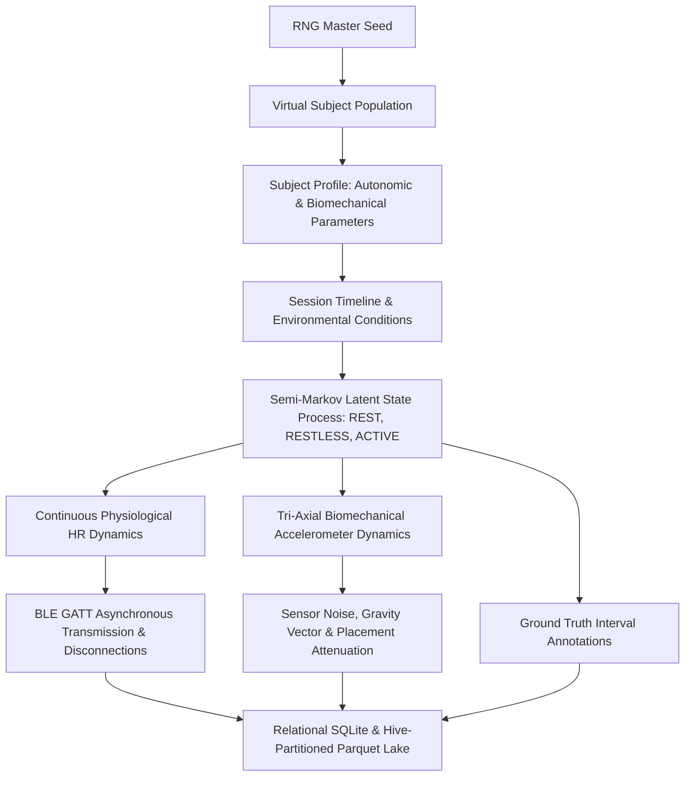

# SleepSense 2.0 — Synthetic Dataset Design & Generative Specification

## 1. Executive Summary & Problem Formulation

SleepSense 2.0 investigates **wearable-assisted nocturnal movement classification and rest pattern analytics** using multimodal sensor inputs: tri-axial accelerometer time series (nominally sampled at 20 Hz) and Bluetooth Low Energy (BLE) heart rate time series (asynchronously arriving at approximately 1 Hz).

Because real-world polysomnography (PSG) datasets with synchronized raw continuous tri-axial smartphone accelerometer telemetry and BLE GATT heart-rate streams are scarce, proprietary, and constrained by clinical privacy regulations, SleepSense 2.0 intentionally implements a **scientifically grounded, hierarchical synthetic sensor simulator**. Rather than fabricating pseudo-clinical measurements or making unverified claims about sleep medicine, this generative engine simulates the biophysical and mechanical dynamics of nocturnal human movement under controlled, reproducible conditions.

### 1.1 Scope & Non-Clinical Disclaimer
> [!IMPORTANT]
> The target labels simulated and predicted by SleepSense 2.0 are **observable physical movement states**:
> - `REST`: Absence of significant macro-movement, dominated by respiratory micro-vibrations and baseline sensor noise.
> - `RESTLESS`: Intermediate transient movements, minor postural adjustments, or limb twitches.
> - `ACTIVE`: Macro-body movements, bed entry/exit, major repositioning, or wakeful motor activity.
>
> **Explicit Non-Clinical Boundary:** SleepSense 2.0 does **not** diagnose sleep disorders, does **not** predict sleep apnea or polysomnography-derived sleep stages (REM, N1, N2, N3 deep sleep), and does **not** claim clinical diagnostic validity.

---

## 2. Generative Hierarchical Architecture

The simulator follows a hierarchical generative graphical model:

---

## 3. Mathematical & Biophysical Modeling

### 3.1 Virtual Subject Population Profile
Each virtual subject $s \in \mathcal{S}$ is parameterized by a tuple:
$$\theta_s = \left( \text{HR}_{\text{base}}, \Delta\text{HR}_{\text{active}}, \Delta\text{HR}_{\text{restless}}, \tau_{\text{rise}}, \tau_{\text{rec}}, \mathbf{R}_{\text{device}}, \alpha_{\text{placement}}, \sigma_{\text{sensor}} \right)$$

- **Baseline Heart Rate** ($\text{HR}_{\text{base}}$): Drawn from $\mathcal{N}(62.0, 5.0)$ bpm, clamped to $[48, 85]$ bpm.
- **Autonomic Acceleration Gains**: Active HR elevation $\Delta\text{HR}_{\text{active}} \sim \mathcal{U}(15.0, 35.0)$ bpm; Restless elevation $\Delta\text{HR}_{\text{restless}} \sim \mathcal{U}(4.0, 12.0)$ bpm.
- **Inertial Time Constants**: Sympathetic rise $\tau_{\text{rise}} \sim \mathcal{U}(6.0, 14.0)$ seconds; Parasympathetic vagal recovery $\tau_{\text{rec}} \sim \mathcal{U}(18.0, 40.0)$ seconds.
- **Device Orientation**: Rotation matrix $\mathbf{R}_{\text{device}} = \mathbf{R}_z(\psi) \mathbf{R}_y(\theta) \mathbf{R}_x(\phi)$ derived from Euler angles $\phi, \theta \sim \mathcal{N}(0, 12^\circ)$, $\psi \sim \mathcal{U}(0, 360^\circ)$.
- **Mechanical Placement Attenuation** ($\alpha_{\text{placement}}$):
  - `MATTRESS`: $\alpha = 1.0$ (standard mattress surface coupling).
  - `BODY_CHEST`: $\alpha = 1.35$ (direct thoracic coupling; amplified ballistic cardiac and respiratory forces).
  - `NIGHTSTAND`: $\alpha = 0.14$ (severe mechanical decoupling; bed macro-movements strongly attenuated through bedframe and nightstand legs).

---

### 3.2 Temporal Latent State Process (Semi-Markov Chain)
Human nocturnal movement does not transition randomly every second. The latent state process $S(t) \in \{\text{REST}, \text{RESTLESS}, \text{ACTIVE}\}$ is governed by a stateful semi-Markov process:

1. **Stationary Transition Matrix**:
   $$P = \begin{bmatrix}
   0 & 0.85 & 0.15 \\
   0.88 & 0 & 0.12 \\
   0.65 & 0.35 & 0
   \end{bmatrix}$$
2. **State Duration Distributions**:
   - `REST`: Lognormal distribution $T_{\text{REST}} \sim \text{LogNormal}(\mu=5.5, \sigma=0.75)$ (median $\approx 245$ s, tail spanning up to 45 minutes).
   - `RESTLESS`: Gamma distribution $T_{\text{RESTLESS}} \sim \text{Gamma}(k=2.8, \theta=4.2)$ (duration 5 to 25 seconds).
   - `ACTIVE`: Gamma distribution $T_{\text{ACTIVE}} \sim \text{Gamma}(k=3.2, \theta=8.5)$ (duration 15 to 90 seconds).

This formulation guarantees realistic nocturnal sleep architecture: long quiescent rest intervals punctuated by short restlessness episodes and occasional active awakenings.

---

### 3.3 Tri-Axial Accelerometer Biomechanical Simulation (20 Hz)
The total simulated acceleration vector $\mathbf{a}(t) \in \mathbb{R}^3$ at sample index $k = t \cdot f_s$ ($f_s = 20\text{ Hz}$) is:

$$\mathbf{a}(t) = \mathbf{R}_{\text{device}} \cdot \begin{pmatrix} 0 \\ 0 \\ g \end{pmatrix} + \alpha_{\text{placement}} \cdot \mathbf{m}(t) + \mathbf{r}(t) + \boldsymbol{\epsilon}_{\text{sensor}}(t)$$

1. **Rotated Earth Gravity**: Earth gravity $g = 9.80665\text{ m/s}^2$ is rotated by the device's 3D resting orientation $\mathbf{R}_{\text{device}}$, providing strict fidelity with the Android `Sensor.TYPE_ACCELEROMETER` hardware contract.
2. **Dynamic Biomechanical Movement** $\mathbf{m}(t)$:
   - When $S(t) = \text{REST}$: $\mathbf{m}(t) = \mathbf{0}$.
   - When $S(t) = \text{RESTLESS}$: A sequence of damped transient sinusoidal wave packets representing limb twitches:
     $$\mathbf{m}(t) = \sum_j A_j \sin(2\pi f_j (t - t_j)) \exp\left(-\frac{t - t_j}{\tau_j}\right) \mathbf{u}_j$$
     with carrier frequencies $f_j \in [1.5, 4.0]\text{ Hz}$ and peak amplitudes $A_j \in [0.4, 1.8]\text{ m/s}^2$.
   - When $S(t) = \text{ACTIVE}$: Band-limited stochastic active force driven by an Ornstein-Uhlenbeck process with peak shocks up to $6.5\text{ m/s}^2$.
3. **Cardiorespiratory Micro-Vibrations** $\mathbf{r}(t)$: Small ballistic recoil ($0.025\text{ m/s}^2$) at respiratory frequency $0.25\text{ Hz}$ and ballistocardiogram harmonic at $1.1\text{ Hz}$.
4. **Thermal Sensor Noise** $\boldsymbol{\epsilon}_{\text{sensor}}(t) \sim \mathcal{N}(\mathbf{0}, \sigma_{\text{sensor}}^2 \mathbf{I})$ with $\sigma_{\text{sensor}} \approx 0.012\text{ m/s}^2$.

---

### 3.4 Physiological Heart Rate Dynamics & BLE Asynchrony (1 Hz)
Heart rate does not change discontinuously upon movement onset. It obeys a first-order continuous-time differential equation representing autonomic tone:

$$\frac{d \text{HR}(t)}{dt} = \begin{cases}
\frac{\text{TargetHR}(S(t)) - \text{HR}(t)}{\tau_{\text{rise}}}, & \text{if } \text{TargetHR} > \text{HR}(t) \\
\frac{\text{TargetHR}(S(t)) - \text{HR}(t)}{\tau_{\text{rec}}}, & \text{if } \text{TargetHR} \le \text{HR}(t)
\end{cases} + \xi_{\text{autonomic}}(t)$$

- **Target Heart Rate**:
  $$\text{TargetHR}(S(t)) = \text{HR}_{\text{base}} + \Delta\text{HR}_{S(t)}$$
- **Physiological Variability** $\xi_{\text{autonomic}}(t)$: Superposition of Respiratory Sinus Arrhythmia (RSA, $0.25\text{ Hz}$) and Mayer waves ($0.10\text{ Hz}$, sympathetic vasomotor tone).
- **Asynchronous BLE Sampling**: BLE Heart Rate Service (UUID `0x180D`, Measurement Characteristic `0x2A37`) emits notify packets at nominal $1\text{ Hz}$ with random clock drift $\Delta t \sim \mathcal{N}(1000\text{ ms}, 35\text{ ms})$.

---

## 4. Controlled Fault Scenarios & Data Quality Degradation

Real-world wireless wearable systems encounter transmission dropped packets, GATT disconnections, and sensor FIFO anomalies. The simulator deterministically injects and logs these faults:

| Fault Type | Simulation Mechanism | Ground-Truth Telemetry Log |
|---|---|---|
| **BLE GATT Disconnection** | Heart rate stream ceases for 30–120 seconds ($p = 0.04$ per session). Window features record `mean_hr = NaN` and `missing_hr_fraction = 1.0`. | `BLE_DISCONNECT` event logged in `data_quality_events`. |
| **Accelerometer FIFO Dropout** | Periodic batch drop of 10–40 samples simulating OS thread starvation. | `ACCEL_DROPOUT` event logged in `data_quality_events`. |
| **Sensor Outlier Saturation** | 8G accelerometer saturation spike representing phone dropped or kicked. | `SENSOR_OUTLIER` event logged in `data_quality_events`. |

---

## 5. Dataset Profiles & Partitioning

The generator supports parameterized profiles to maintain memory bounds on development machines:

| Dataset Profile | Virtual Subjects | Sessions / Subject | Total Sessions | Total Hours | Target Use Case |
|---|---|---|---|---|---|
| **`SMALL`** (Standard Benchmark) | 12 | 3 | 36 | 18.0 h | Primary development, SQL analytics, baseline model benchmarking, ablation studies. |
| **`SHIFTED`** (Domain Shift Evaluation) | 10 | 3 | 30 | 15.0 h | Evaluation of model robustness under nightstand placement, high noise, and altered autonomic recovery. |
| **`MEDIUM`** | 24 | 4 | 96 | 48.0 h | Extended validation and stress-testing. |
| **`LONG_SESSION`** | 8 | 1 | 8 | 64.0 h | Full 8-hour continuous nocturnal overnight sessions. |

### 5.1 RNG Seed Management & Reproducibility
- Base seed: `42`.
- Subject profile generator: `seed + subject_idx * 1000`.
- Session timeline generator: `subject_seed + session_idx * 100`.
All pseudo-random state transitions, continuous waveforms, and injected dropouts are strictly deterministic and reproducible.
