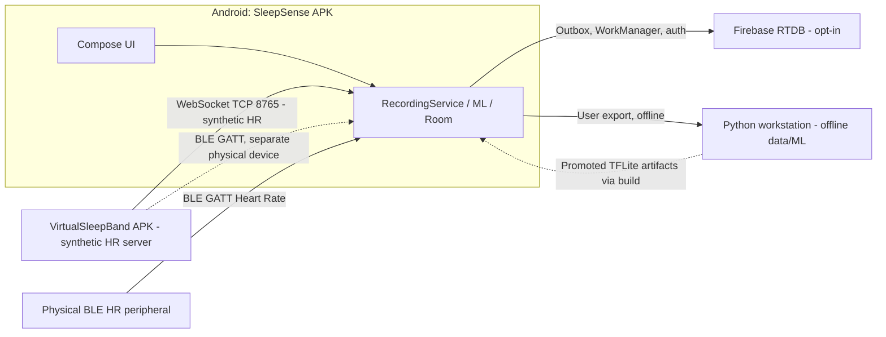

# 01 — System context and deployment boundaries

Level: system/container view. Solid arrows denote supported interfaces; this is not a Bluetooth-radio test report.

Grounding: `settings.gradle.kts`, `data/ble/SwitchingDeviceTransport.kt`, `RecordingService.kt`, `virtualsleepband/websocket/VirtualWearableWebSocketServer.kt`, `cloud/CloudRecovery.kt`. WebSocket is not BLE.
