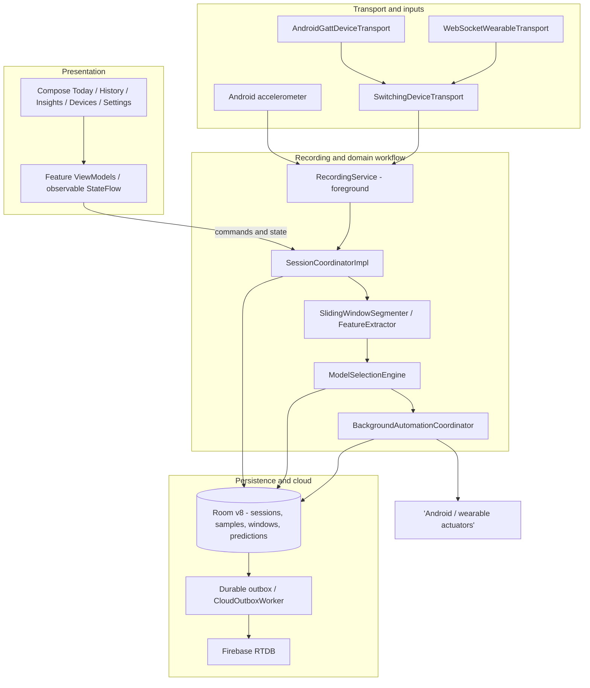

# 02 — Android application components

Runtime responsibility view, not a claim of strict dependency inversion.

`AppContainer` holds manual dependency wiring. Legacy `ble/MockBleConnector` is a separate diagnostic API and is not shown as production `DeviceTransport`.
