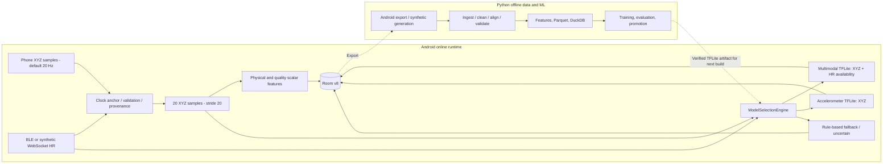

# 03 — Sensor and ML pipeline; online versus offline

**Android runtime:** 20 Hz is the default requested accelerometer rate, not a guarantee. The coordinator creates 20-sample windows with stride 20. Model tensor shape is `[1,20,3]`; Python's scalar feature dictionaries are not its direct input.

Grounding: `RecordingService.kt`, `SessionCoordinatorImpl.kt`, `SignalProcessingPipeline.kt`, `ModelSelectionEngine.kt`, `pipelines/features/feature_extractor.py`, `ml/artifacts/deployment_manifest.json`. Fresh HR maximum age is 10 s. A full window is nominally one second at 20 Hz, with approximately 950 ms between first and last sample timestamps.
