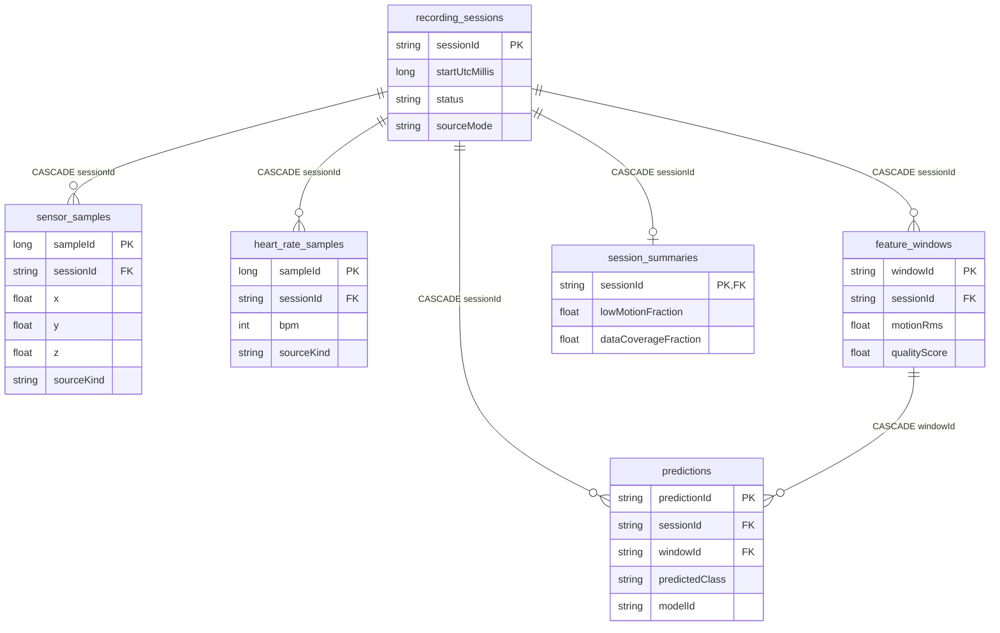

# 04 — Room v8 schema and enforced relationships

Canonical schema: `app/schemas/com.example.sleeptrackersimulator.history.SleepTrackerDatabase/8.json`. Lines below represent **actual declared foreign keys**, not conceptual relationships inferred from table names.

Other tables in v8 without **declared database-level foreign keys** in the exported Room schema: `sensor_records`, `actuator_events`, `cloud_outbox`, `cloud_active_session`, `cloud_delivery_intents`, `cloud_session_deletions`, `smart_rules`, `smart_rule_executions`, `personal_baselines`, `devices`. Some have logical references managed in application code; do not misrepresent them as enforced SQL FKs.

Room keeps migration schemas v1–v8 under `app/schemas/`; retain every committed schema JSON used by migration tests.
