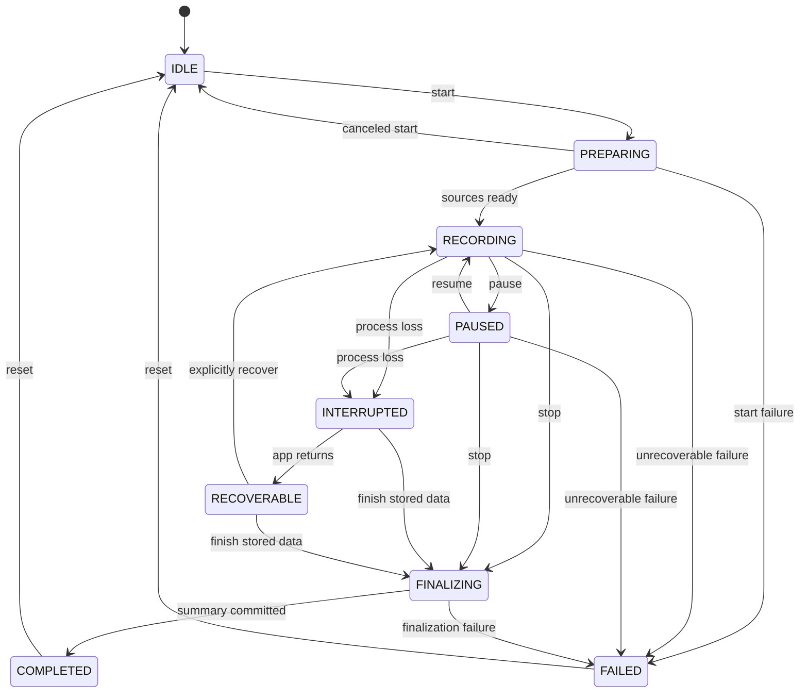

# 05 — Recording session lifecycle

Model states come from `core/model/RecordingSession.kt`. `RecordingService` returns `START_NOT_STICKY`; restart recovery must not fabricate uninterrupted sensor collection.

Diagram describes the allowed domain transitions; the normal UI may expose a subset of recovery actions. Actual foreground-service start ordering and persistence behavior must be regression-tested.
