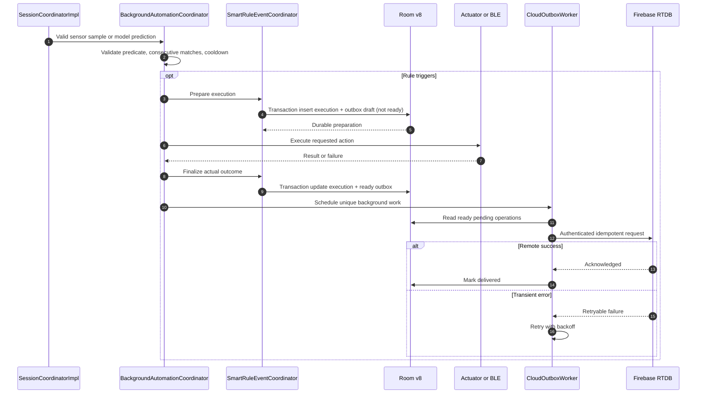

# 06 — Rule action, durable outbox and Firebase delivery

External actuator calls are **not** part of an atomic SQLite transaction. The code prepares a durable record/outbox draft, invokes the actuator, then finalizes outcomes. Crash recovery reconciles incomplete entries.

Grounding: `smart/SmartRuleEventCoordinator.kt`, `smart/BackgroundAutomationCoordinator.kt`, `cloud/CloudRecovery.kt`, `cloud/CloudOutboxPersistence.kt`. Actual remote delivery is conditional on consent and credentials.
