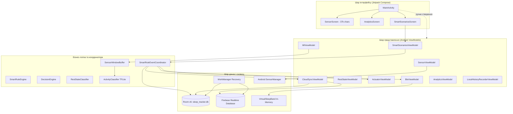

# Архітектурний аудит поточної системи (Labs 1–7)

**Дата аудиту:** 26 жовтня 2026 року  
**Вихідний стан:** гілка `release/labs-1-7-verified`, коміт `9a48e0e0e62c19dfa2f0870f2649af9fb8982682`  
**Базові перевірки:** 158/158 JVM Unit Tests PASS, Firebase Rules 8/8 PASS, Room Migrations 1→6 PASS.

---

## 1. Загальний огляд системи

Проєкт `SleepTrackerSimulator` у вихідному стані є інтегрованою платформою для виконання семи університетських лабораторних робіт з дисципліни ПМСС (Програмування мобільних сенсорних систем).

Система об'єднує:
1. **Збір сенсорних даних (ЛР1):** `AndroidAccelerometerDataSource` реєструє слухач акселерометра через `SensorManager`, обчислює евклідову норму $L_2 = \sqrt{x^2+y^2+z^2}$, динамічну інтенсивність $|L_2 - 9.81|$ та класифікує стан на `STILL` / `MOVEMENT`.
2. **BLE-емуляцію (ЛР2):** `MockBleScanner`, `MockBleConnector` та `VirtualSleepBand` моделюють підключення до BLE-браслета (Heart Rate Service `0x180D`, Measurement `0x2A37`, Body Sensor Location `0x2A38`), генерацію симульованого пульсу та обробку кастомних команд через `IBleConnector`.
3. **Хмарну синхронізацію (ЛР3):** `FirebaseCloudRepository` (RTDB під `/users/{uid}/sessions/{sessionId}`), анонімну автентифікацію, стійкий outbox у Room (`cloud_outbox`) та фонове відновлення через `WorkManager` (`CloudRecoveryWorker`).
4. **Актуатори (ЛР4):** `AndroidSmartActuator` (вібрація через `VibratorManager`, ліхтарик через `CameraManager`), локальні та віддалені команди через `FirebaseRemoteControlRepository`.
5. **Локальне сховище та аналітику (ЛР5):** Room Database v6 (`SleepTrackerDatabase`), сутність `SensorRecord`, репозиторій `RoomSensorHistoryRepository`, графік Vico у `AnalyticsScreen`.
6. **On-Device ML (ЛР6):** TensorFlow Lite модель `activity_classifier.tflite` з вхідним тензором $[1, 20, 3]$, буфером `SensorWindowBuffer`, класифікацією станів `REST`, `RESTLESS`, `ACTIVE`.
7. **Комплексну інтеграцію (ЛР7):** `SmartRuleEventCoordinator`, стійкі транзакції Room перед активацією актуатора, прив'язку correlation ID, дедуплікацію та оновлення статусів доставки.

---

## 2. Інвентаризація компонентів та їхніх зв'язків

---

## 3. Аналіз життєвого циклу (Lifecycle & Process Boundaries)

1. **Composition Root:** `MainActivity` бере на себе відповідальність за ручне інстанціювання бази даних, репозиторіїв, координаторів та 9 фабрик `ViewModel`. У проєкті відсутній фреймворк впровадження залежностей (Hilt).
2. **Власник фонового збору:** Акселерометр прив'язаний до життєвого циклу `SensorViewModel` (через `viewModelScope` та реєстрацію у `onResume`/`onPause` або прапорець `isMonitoring`).
3. **ML-пайплайн:** `MlViewModel` збирає вікна вимірювань і викликає TFLite-інференс всередині `viewModelScope`. Якщо користувач згортає застосунок або перемикає екран, обробка припиняється або ризикує перерватися через знищення ViewModel.
4. **Відсутність Foreground Service:** У `AndroidManifest.xml` не оголошено сервісів з типом `foregroundServiceType="health"` чи `connectedDevice`, що блокує можливість стабільного багатогодинного нічного моніторингу заблокованого пристрою в Android 12–16+.

---

## 4. Стан сховища даних (Room v6)

База даних `SleepTrackerDatabase` (версія 6) містить такі сутності:
- `sensor_records`: `id`, `timestamp`, `sensorType`, `sensorValue`, `actionTriggered`. (Зберігає узагальнене скалярне значення, без сирих осей X/Y/Z).
- `actuator_events`: журнал активацій вібратора/ліхтарика.
- `cloud_outbox`: стійка черга операцій із підтримкою `readyForDelivery` (додано в міграції 5→6 для атомарності ЛР7).
- `cloud_active_session`: метадані поточної хмарної сесії (`sessionId`, `startedAt`, `ownerUid`, `monitoringActive`).
- `smart_rules`: визначення правил автоматизацій.
- `smart_rule_executions`: детальний аудит виконань правил із correlation ID, знімком назви правила та статусами актуатора/BLE/хмари.

---

## 5. Стан Machine Learning

- **Модель:** TFLite FlatBuffer, згенерована скриптом `ml/train_activity_model.py`.
- **Вхід:** тензор форми $[1, 20, 3]$ (Float32). За частоти 20 Гц вікно становить 1,0 с.
- **Внутрішній preprocessing:** у Keras-графі перший шар — `Lambda(lambda x: x - tf.reduce_mean(x, axis=1, keepdims=True))` (віднімання середнього за вікном).
- **Вихід:** 3 класи (`REST`, `RESTLESS`, `ACTIVE`).
- **Синтетичність:** модель навчена на синтетичних синусоїдах з шумом і гравітацією. На тестовій синтетичній вибірці точність становить ~99%, проте вона не відображає реальні рухи людини у ліжку.

---

## 6. BLE-підсистема

- Реалізована як in-memory симуляція (`VirtualSleepBand`, `MockBleConnector`).
- Повністю реалізовано протокол GATT Heart Rate (`0x180D`, `0x2A37`, `0x2A38`).
- Підтримує відправлення кастомних команд через `IBleConnector.sendData(String)` та отримання ACK.
- **Обмеження:** не підтримує підключення до реального апаратного BLE-периферійного пристрою і не може виступати BLE GATT сервером на фізичному пристрої.

---

## 7. Firebase-підсистема

- Працює за схемою Durable Outbox Pattern: вимірювання та події правил спершу записуються в Room, а потім синхронізуються у Firebase Realtime Database.
- Безпека гарантується `database.rules.json` з перевіркою `auth.uid === $uid`, строгими схемами полів та типами.
- **Обмеження:** структура RTDB тісно прив'язана до лабораторного моніторингу, не має чіткого виокремлення легких сесійних summaries від важких телеметричних потоків.
