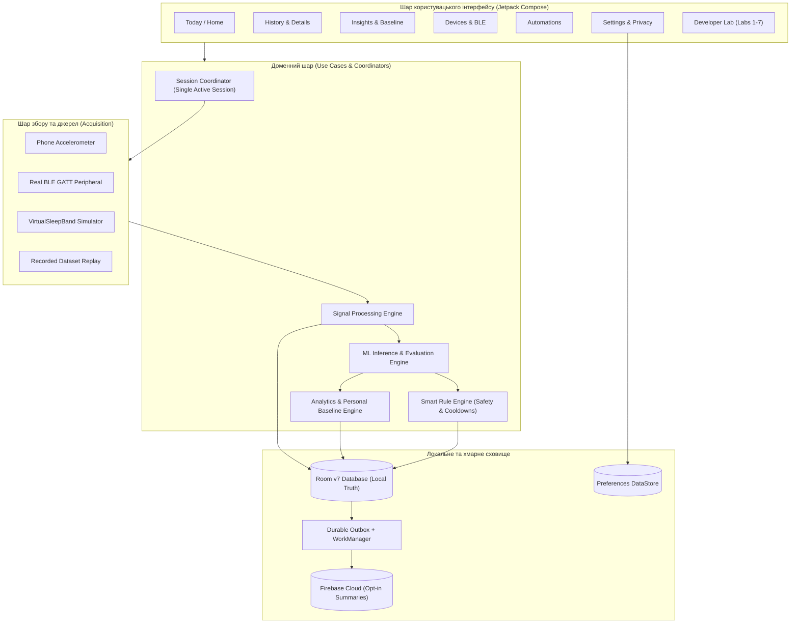
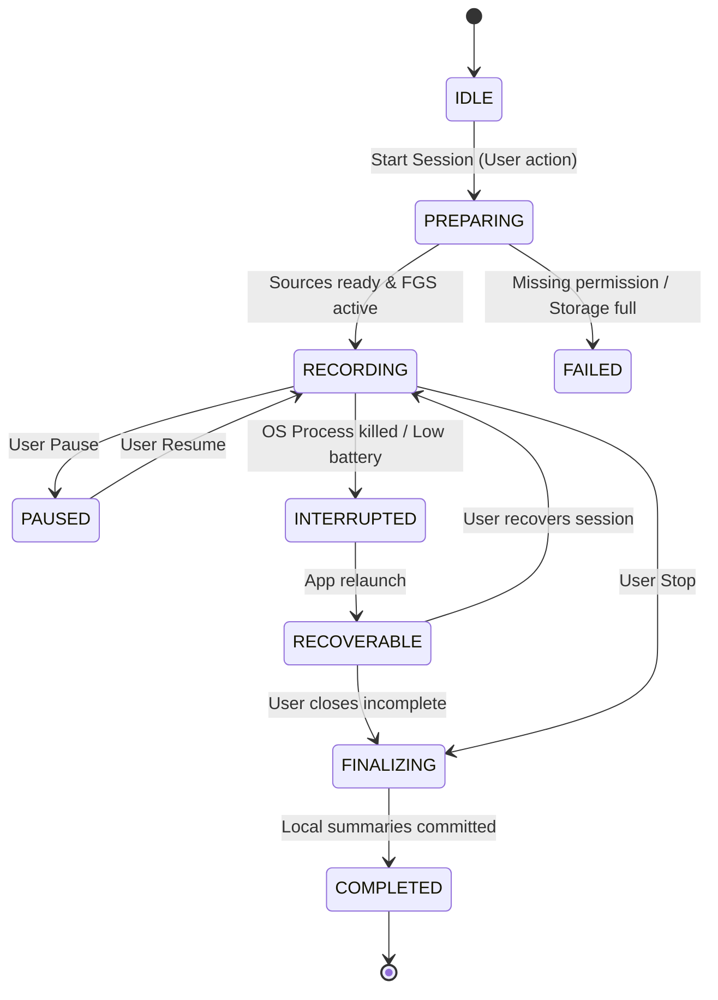

# Цільова продуктова архітектура: SleepSense 2.0

**Продукт:** SleepSense — персональний щоденник нічної рухової активності з локальним ML-аналізом.  
**Концепція:** Offline-first, Privacy-first, ML з доказами, Clean Material 3 UX.

---

## 1. Загальна схема системи



---

## 2. Станова модель сесії (Session Lifecycle)

У кожен момент часу на пристрої існує максимум **одна активна сесія**, що має стабільний UUID.



### Ключові гарантії:
- **Session-Owned Processing:** Інференс та обробка належать `SessionCoordinator` у `RecordingService`, а не ViewModel.
- **Екран заблоковано:** Сесія продовжує збір за заблокованого екрана через Foreground Service.
- **Неупередженість даних:** При збоях дані не домальовуються; пропуск фіксується як `DATA_GAP`.

---

## 3. Модель збереження даних: Room Database v7

### Нова ER-модель:
- `recording_sessions`: первинний запис сесії (`sessionId`, `startedAtUtc`, `endedAtUtc`, `status`, `sourceMode`, `placement`, `dataCoverage`).
- `sensor_samples`: тривісні відліки $x, y, z$, час у наносекундах та UTC, `qualityScore`, `sourceKind`.
- `heart_rate_samples`: частота серцевих скорочень (bpm), походження (`BLE_REAL` або `SIMULATED`), часова невизначеність.
- `feature_windows`: сегментовані вікна (наприклад, 20-100 відліків) з розрахованими ознаками (`motionRms`, `variance`, `jerk`, `coverage`).
- `predictions`: результати класифікації моделі (`predictedClass`, `probabilities`, `confidence`, `modelVersion`, `latencyNs`).
- `session_summaries`: підсумки сесії (`lowMotionFraction`, `movementEpisodeCount`, `dataCoverageFraction`, `comparabilityFlags`).
- `personal_baselines`: збережені індивідуальні метрики користувача (медіани, MAD, перцентилі) на базі сумісних сесій.
- `devices`: зареєстровані джерела даних та їхні можливості.
- `legacy_sensor_records`: збережена таблиця `sensor_records` з Room v6 для повної зворотної сумісності.
- `smart_rules` та `smart_rule_executions`: збережені з ЛР7 сутності автоматизацій.
- `cloud_outbox`: черга відкладеної синхронізації з підтримкою транзакційності.

---

## 4. BLE Transport Contract

Єдиний інтерфейс взаємодії з пристроями:
```kotlin
interface DeviceTransport {
    val connectionState: StateFlow<DeviceConnectionState>
    val measurements: SharedFlow<TransportMeasurement>

    suspend fun startScan(): Flow<DiscoveredDevice>
    suspend fun stopScan()
    suspend fun connect(deviceId: String): Result<Unit>
    suspend fun disconnect()
    suspend fun executeCommand(command: DeviceCommand): Result<CommandAcknowledgement>
}
```

### Реалізації:
1. `MockDeviceTransport`: швидка in-process симуляція `VirtualSleepBand` (збереження сумісності ЛР2).
2. `ReplayDeviceTransport`: детерміноване відтворення записаних сесій для тестування та валідації.
3. `AndroidGattDeviceTransport`: реальний клієнт Bluetooth Low Energy GATT (`BluetoothGattCallback`, серіалізація операцій, підписка на CCCD, обробка розривів та reconnect).

Окремий артефакт/модуль `virtual-band` створюється як самостійний застосунок/сервер, що анонсує Heart Rate Service (`0x180D`) через `BluetoothLeAdvertiser` та підтримує двосторонній зв'язок.

---

## 5. Machine Learning 2.0 та персоналізація

1. **Багаторівневий ML:**
   - **Рівень вікна (1-2.5 с):** TFLite класифікатор (три класи: `REST`, `RESTLESS`, `ACTIVE`).
   - **Рівень хвилини (60 с):** фільтрація викидів, згладжування ймовірностей, стабільний стан руху.
   - **Рівень сесії:** агрегація рухових епізодів, відсоток низької активності, якість покриття.
   - **Рівень користувача (baseline):** персональні медіани та квартилі після $\ge 5$ валідних сесій з однаковим placement.
2. **Data Provenance:** Заборона змішування симульованих сигналів у персональну історію. Чіткий лейбл у кожному вікні.
3. **Uncertainty & Quality:** Окремі метрики для впевненості моделі, якості покриття сигналу та наявності артефактів.

---

## 6. Продуктова інформаційна архітектура UI

1. **Today / Home:**
   - Верхня картка: Hero Card поточної сесії (`Start` / `Pause` / `Finish`).
   - Компактні показники: остання сесія, статус підключеного джерела, якість сигналу.
2. **History:**
   - Календар / список сесій із фільтрами за джерелом, типом (Real/Demo) та якістю.
   - Деталізація сесії: горизонтальний таймлайн рухів з явними проміжками втрати даних, графік інтенсивності, розподіл класів.
3. **Insights:**
   - Порівняння з персональним baseline за 7, 30, 90 днів.
   - Текстові пояснення без медичних псевдообіцянок.
   - Quality gate: сповіщення про недостатність сесій для надійного порівняння.
4. **Devices:**
   - Керування джерелами: телефон, зовнішній BLE-браслет, симулятор.
   - Перегляд GATT характеристик, заряду батареї, якості зв'язку.
5. **Automations:**
   - Покроковий конструктор правил безпеки з cooldown, перевіркою якості та тестуванням на replay.
6. **Settings & Privacy:**
   - Offline-only за замовчуванням, opt-in хмара, експорт даних, локальне видалення.
7. **Developer Lab:**
   - Повний доступ до діагностики кожної з семи лабораторних робіт (Sensor Inspector, BLE Inspector, Cloud Inspector, Actuator Inspector, ML Inspector, Room Inspector, Pipeline Trace).
