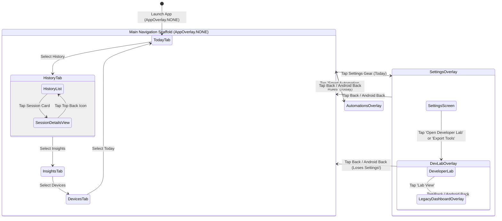

# SleepSense 2.0 — Navigation Architecture & User Journeys

## 1. Architectural Overview

SleepSense 2.0 uses a custom state-driven navigation architecture implemented directly within `MainActivity.kt`. It combines two primary navigation paradigms:
1. **Persistent Bottom Navigation**: A 4-destination `NavigationBar` controlling `AppTab` (`TODAY`, `HISTORY`, `INSIGHTS`, `DEVICES`).
2. **Modal Screen Overlays**: A top-level state enum `AppOverlay` (`NONE`, `SETTINGS`, `AUTOMATIONS`, `DEVELOPER_LAB`, `LEGACY_DASHBOARD`) that swaps out the entire `Scaffold` when active.
3. **Internal Screen State Switches**: Sub-views toggled inside individual screens (e.g., `selectedSessionDetails != null` inside `HistoryScreen.kt`).

---

## 2. End-to-End User Journeys

### Journey 1: First-Time Onboarding & 10-Second Orientation
- **Persona**: A consumer interested in sleep wellness who downloads SleepSense for the first time.
- **Goal**: Understand what the application does, verify device readiness, and understand the difference between smartphone tracking and wearable sensors within 10 seconds.
- **Current Experience**:
  - The user opens the app and lands directly on `TodayScreen`.
  - The headline reads: `Tonight's Session - Monitor device movement and view your activity timeline afterward.`
  - A green badge indicates `READY TO RECORD`, and a chip displays `PHONE Phone Accelerometer · Ready`.
  - Below this, an empty card reads `No recorded sessions yet` with a brief note explaining to start tonight's session.
- **Friction Points**:
  - **No Welcome / Value Proposition**: The app does not explain *how* phone accelerometry tracks sleep (e.g. phone placement on the mattress near pillow).
  - **Missing Placement Selector**: The user is not prompted to confirm device placement (Mattress vs Nightstand vs Body) before pressing `Start Recording`.
  - **Misleading Button Placement**: Below the last session card sits a prominent outlined button labeled `Smart Automation Rules`. New users do not know what an automation rule is or why they need it before recording a single night.

---

### Journey 2: Overnight Sleep Recording Workflow
- **Persona**: A user going to bed who wants to track their movement patterns overnight.
- **Step-by-Step Flow**:
  1. **Preparation**: User opens app at bedtime.
  2. **Initiation**: User taps `Start Recording`.
     - *Permission Check*: App checks `Manifest.permission.ACTIVITY_RECOGNITION`. If not granted, the system permission dialog is displayed.
     - *Service Start*: `RecordingService.start(this, mode, placement)` is triggered as a foreground service with a persistent notification.
  3. **In-Progress Monitoring**:
     - The hero card transitions immediately to the `RECORDING IN PROGRESS` state.
     - A green pulsating status badge appears.
     - A digital timer starts counting (`00:00:01`, `00:00:02`...).
     - Telemetry note: `Phone sensor active · 20 Hz · On-device TFLite model`.
  4. **Mid-Night Interactions**:
     - User can tap `Pause` -> State changes to `SESSION PAUSED` with an amber badge.
     - User taps `Resume` -> Recording continues.
  5. **Morning Completion**:
     - User wakes up and taps `Finish` (Red button).
     - `RecordingService.stop()` finalizes sample batches, invokes `SessionCoordinator.stopSession()`, writes the `SessionSummary` to Room v7, and computes low-motion fraction.
     - The hero card returns to `READY TO RECORD`, and the `Last Session Summary` card immediately displays the fresh duration and low-motion percentage.
- **Friction Points**:
  - **Accidental Stop Hazard**: Tapping `Finish` immediately terminates the session without a confirmation prompt or hold-to-stop interaction. In a groggy morning state, accidental taps can prematurely close or interrupt sessions.
  - **Screen Burn-In / Sleep Mode**: There is no dedicated dimmed "Bedtime Clock" mode. If the user leaves the screen on, the vibrant blue buttons remain fully lit.

---

### Journey 3: Wearable Device Discovery & Simulation Pairing
- **Persona**: A student or evaluator testing wearable integration.
- **Step-by-Step Flow**:
  1. User navigates to the `Devices` tab.
  2. The screen shows `THIS PHONE (Android Accelerometer)` and `BLUETOOTH WEARABLES`.
  3. User sees two outlined buttons: `REAL BLE` and `DEMO`.
  4. If `REAL BLE` is chosen: User taps `Search for devices`.
     - *Permission Check*: App requests `BLUETOOTH_SCAN` and `BLUETOOTH_CONNECT`.
     - Discovered devices appear as a vertical stack of buttons with MAC addresses, RSSI dBm, and source tags.
  5. If `DEMO` is chosen: App uses `MockDeviceTransport` to simulate instant connection with a virtual band.
  6. Upon connection:
     - Connected card updates with `Virtual Sleep Band`, `GATT Service 0x180D · 0x2A37`.
     - Live BPM pulses in red (`68 BPM`).
- **Friction Points**:
  - **Two Redundant Scan Buttons**: Screen shows `Search for devices` at the top and another `Scan` button inside the card below.
  - **No Scanning Feedback**: When scanning is active, there is no progress bar or scanning animation in `DevicesScreen.kt`. The state only changes to `State: SCANNING`.
  - **Confusing Companion Guidance**: The text advises running `VirtualSleepBand` on a second device, but does not explain that single-device testing can also use the loopback advertiser in `DeveloperLab`.

---

### Journey 4: Historical Analysis & Timeline Exploration
- **Persona**: A user reviewing their past week of sleep data.
- **Step-by-Step Flow**:
  1. User selects `History` tab.
  2. Top filter chips allow toggling between `All (N)`, `Real Only`, and `Demo`.
  3. User scrolls through the `LazyColumn` of session cards.
  4. User taps a specific session card.
  5. The screen replaces the list with `SessionDetailsView`.
  6. User views observation hours, low-motion percentage, and the `Movement Activity Timeline` (green REST, amber RESTLESS, blue ACTIVE segments).
  7. User reads the scientific disclaimer explaining that accelerometry reflects movement, not clinical polysomnography.
- **Critical Defects**:
  - **CRITICAL NAV BUG (P1)**: If the user presses the Android back gesture or hardware back button while in `SessionDetailsView`, the application exits entirely instead of returning to the session list! There is no `BackHandler` attached to `selectedSessionDetails`.
  - **Bottom Bar Intrusion**: The persistent bottom navigation bar remains rendered underneath `SessionDetailsView`, violating Material 3 hierarchical drill-down guidelines.
  - **Accidental Deletion**: Tapping the trash icon in the header immediately deletes the session from Room without an alert dialog.

---

### Journey 5: Personal Baseline & Insights Analysis
- **Persona**: A user seeking to understand whether their sleep restfulness is improving.
- **Step-by-Step Flow**:
  1. User selects `Insights` tab.
  2. If the user has fewer than 3 real sessions:
     - A warning card appears: `Personal baseline in progress. You currently have X comparable session(s). A reliable personal baseline requires at least 3-5 consistent observations with compatible device placement and high data coverage.`
  3. User taps `Demo (90)` chip to explore what a full baseline looks like:
     - Metrics update instantly: `Avg Duration: 7h 46m`, `Avg Low-Motion: 80%`, `Movement: 15.6 episodes/night`, `Coverage: 91%`.
     - `Nightly low-motion trend` displays a 90-point polyline.
  4. If real sessions >= 3:
     - Baseline comparison card appears: `Compared with Baseline: Current low-motion 84% (+4.0 pp). Movement is within your individual normal variation range.`
- **Friction Points**:
  - **Unlabeled Trend Chart**: The trend graph is a bare line with no dates, no percentages, and no axis labels. Users cannot determine *when* an anomaly occurred.
  - **No Onboarding from Empty State**: When `Real` mode has 0 sessions, no action button is provided to direct the user to start their first recording.

---

### Journey 6: Creating & Managing Smart Automation Scenarios
- **Persona**: A user configuring their phone to pulse vibration when restlessness is detected.
- **Step-by-Step Flow**:
  1. From `TodayScreen`, user taps `Smart Automation Rules`.
  2. `AppOverlay.AUTOMATIONS` is activated.
  3. User sees the (currently defective) screen with `Add rule` button.
  4. User taps `Add rule`.
  5. An `AlertDialog` opens with rule configuration fields:
     - Name: `Restless sleep alert`
     - Source: User clicks `CycleButton` until `ML_CLASS` appears.
     - Class: User clicks `CycleButton` until `RESTLESS` appears.
     - Action: User clicks `CycleButton` until `VIBRATION_PULSE` appears.
     - Consecutive matches: `3`
     - Cooldown ms: `5000`
  6. User taps `Save`.
  7. The rule is committed to Room `smart_rules` table and appears in the list.
  8. During an active session, when 3 consecutive windows classify as `RESTLESS`, `SmartRuleEngine` triggers the actuator pulse.
- **Friction Points**:
  - **Severe Visual Contrast Defect (P0)**: As identified in Phase 2, text is nearly invisible black-on-black.
  - **Status Bar Overlap (P0)**: Top bar overlaps Android status bar clock and icons.
  - **Cycle Button Anti-pattern (P1)**: Forcing users to click a button 5 times to cycle through an enum is non-standard and frustrating.
  - **Zero Confirmation on Delete (P1)**: Tapping `Delete` removes the rule instantly.

---

### Journey 7: Laboratory Verification & Diagnostic Deep Dive
- **Persona**: A professor, teaching assistant, or student defending University Labs 1 to 7.
- **Step-by-Step Flow**:
  1. From `TodayScreen`, user taps Settings gear icon -> `SettingsScreen`.
  2. User scrolls to `ADVANCED / PORTFOLIO` and taps `Open Developer Lab`.
  3. `DeveloperLabScreen` opens with 7 scrollable tabs:
     - `Sensors (L1)`: Verifies continuous 20 Hz accelerometry and timestamp calibration.
     - `BLE (L2)`: Inspects Service UUID `0x180D`, tests alert command, starts GATT server.
     - `Cloud (L3)`: Inspects Firebase outbox, durable SQLite recovery queue, and security rules.
     - `Actuators (L4)`: Tests manual vibration, persistent vibration, flashlight torch, emergency OFF, and automatic movement alert switch.
     - `Room (L5)`: Inspects database schema v7, generates 90-night synthetic dataset, imports/verifies Room integrity, exports CSV.
     - `ML (L6)`: Inspects tensor `[1, 20, 3]`, collects live ground-truth training data with protocol/placement labels, exports CSV.
     - `Pipeline Trace (L7)`: Validates 8-stage architectural pipeline.
  4. User taps `Lab View` button in header -> `SensorScreen` opens, demonstrating all 7 subsystems on a single scrolling screen.
- **Friction Points**:
  - **Broken Back-Stack**: Navigating `Settings` -> `Developer Lab` -> Pressing Back returns directly to `TodayScreen`, bypassing `Settings`. The navigation stack has no memory.
  - **Header Overlap in Both Consoles**: Both `DeveloperLabScreen` and `SensorScreen` clip into the system status bar.

---

### Journey 8: VirtualSleepBand Companion Workflow
- **Persona**: Evaluator running multi-device over-the-air BLE verification.
- **Step-by-Step Flow**:
  1. Evaluator launches `VirtualSleepBand` on Device B (or Emulator 2).
  2. Evaluator selects scenario (e.g. `Deep Sleep - Slow regular rhythm`).
  3. Evaluator taps `START BLE ADVERTISING`.
  4. Device A (running SleepSense) discovers `Virtual Sleep Band` and connects.
  5. Device B shows `Connected Centrals: 1 device(s)` and begins transmitting simulated heart rate packets every 1000ms.
  6. Evaluator views incoming write commands in the `Received Commands Log`.
- **Friction Points**:
  - `VirtualBandScreen` has no in-app scenario description; users must guess what each scenario simulates.

---

## 3. Systematic Navigation Defects Summary

| Defect ID | Severity | Description | Current File & Line | User Impact | Fix Specification |
| :--- | :--- | :--- | :--- | :--- | :--- |
| **NAV-01** | **P1** | `SessionDetailsView` lacks `BackHandler` | `HistoryScreen.kt:61-67` | Pressing system back exits application instead of returning to list | Add `BackHandler { onCloseDetails() }` inside `SessionDetailsView` |
| **NAV-02** | **P2** | Bottom Navigation Bar leaks into `SessionDetailsView` | `MainActivity.kt:412-520` | Detail screen looks crowded and violates M3 drill-down pattern | Hide `NavigationBar` when `selectedSessionDetails != null` or make details a dedicated overlay/route |
| **NAV-03** | **P2** | Modal overlays do not maintain a back stack | `MainActivity.kt:252, 278-409` | Navigating Settings -> DevLab -> Back skips Settings, jarring the user | Replace single `activeOverlay` enum with a backstack `ArrayDeque<AppOverlay>` |
| **NAV-04** | **P1** | Today screen cannot configure source mode or placement | `TodayScreen.kt:64-217` | User cannot select Mattress/Nightstand or Wearable before recording | Add placement and source mode selection chips/sheet to `SessionHeroCard` |
| **NAV-05** | **P0** | All overlay screens clip into status bar | `MainActivity.kt:295, 333, 361` | Back arrow and titles overlap with battery, wifi, and clock | Wrap overlay contents in `Scaffold` or add `.statusBarsPadding()` modifier |
| **NAV-06** | **P1** | Unconfirmed destructive actions (Delete Session, Delete Rule) | `HistoryScreen.kt:246`, `SmartScenariosScreen.kt:64` | Accidental tap permanently deletes database records | Add confirmation `AlertDialog` for all delete triggers |
