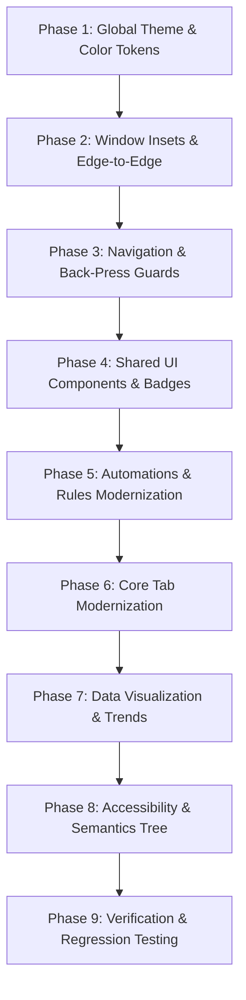

# SleepSense 2.0 — Safe Incremental Implementation Plan

## 1. Core Engineering Safeguards & Guarantees

Before writing a single line of production UI code, we establish strict **non-negotiable safety boundaries** to ensure that redesigning the presentation layer does not destabilize the existing university laboratory backends or core application lifecycle.

### Critical Subsystem Invariants:
1. **`RecordingService` & `SessionCoordinator`**:
   - The Android foreground service lifecycle, notification channels, wake-lock acquisition, and 20 Hz continuous sensor collection must NOT be modified.
   - UI changes may only trigger `RecordingService.start()`, `pause()`, `resume()`, and `stop()`.
2. **On-Device TFLite Interpreter (`ActivityClassifier`)**:
   - The application-scoped lifecycle of the TFLite interpreter must remain strictly untouched.
   - Buffer windowing (`SensorWindowBuffer(20)`), 1-second inference cycles, golden-vector parity, and float32 tensors must not be altered.
3. **Bluetooth Low Energy (`SwitchingDeviceTransport` & `GattRegistrationSequencer`)**:
   - The GATT Heart Rate Service (`0x180D`), characteristic `0x2A37`, and descriptor `0x2902` sequencing must remain intact.
   - Dual-role radio warnings and loopback advertiser behavior must be preserved.
4. **Room Database Schema v7**:
   - The database version (v7), entities, migration paths (`1 -> 7 PASS`), indices, foreign keys, and CASCADE delete rules must NOT be altered.
   - Demo night generator and dataset import/reset functions must remain identical.
5. **Firebase Outbox & Recovery Scheduler**:
   - Durable SQLite outbox queues, WorkManager synchronization, idempotency keys, and security rules guarantees must not be modified.
6. **Actuator Cooldown & Hardware Safety**:
   - The 15-minute rate limit, local OFF override latch, and emergency shutdown mechanisms must remain directly wired to the UI.
7. **Data Provenance Isolation**:
   - Real phone sensor data (`PHONE_REAL`) and simulated wearable/demo data (`SIMULATED`) must remain strictly isolated. Synthetic data must NEVER be mixed into personal baselines.

---

## 2. Multi-Stage Incremental Roadmap

The implementation is structured into **nine sequential phases**. Each phase is verified through automated tests and screenshot capture before proceeding to the next.

---

### Phase 1: Global Theme & Semantic Color System
- **Objective**: Fix the black-on-black contrast defect and establish the M3 design token foundation.
- **Tasks**:
  1. Update `Color.kt` with high-contrast, accessible tokens (`NightBase`, `SurfaceLow`, `SurfaceCard`, `LavenderAccent`, `EmeraldCalm`, `AmberMotion`, `CoralAlert`).
  2. Fully populate `darkColorScheme()` in `Theme.kt` with all Material 3 roles (`onSurfaceVariant`, `onPrimary`, `outline`, `surfaceContainer`, `errorContainer`).
  3. Build a complete `lightColorScheme()` definition.
  4. Connect `darkTheme` parameter in `SleepTrackerTheme` to `isSystemInDarkTheme()`.
- **Target Files**: `ui/theme/Color.kt`, `ui/theme/Theme.kt`.
- **Verification**: Verify that `LocalContentColor.current` resolves to `#F8FAFC` in dark mode and `#0F172A` in light mode.

---

### Phase 2: Window Insets & Edge-to-Edge Layout Normalization
- **Objective**: Resolve system status bar overlaps across all modal screens.
- **Tasks**:
  1. In `MainActivity.kt`, wrap all overlay destinations (`AUTOMATIONS`, `SETTINGS`, `DEVELOPER_LAB`, `LEGACY_DASHBOARD`) in a `Scaffold(containerColor = MaterialTheme.colorScheme.background)`.
  2. Ensure each overlay uses an M3 `TopAppBar` or applies `Modifier.statusBarsPadding()`.
  3. Verify that bottom navigation bars and floating buttons respect `WindowInsets.navigationBars`.
- **Target Files**: `app/src/main/java/com/example/sleeptrackersimulator/app/MainActivity.kt`.
- **Verification**: Capture emulator screenshots of all overlay headers; verify zero overlap with the status bar clock and battery icons.

---

### Phase 3: Navigation Architecture & Safety Back-Press Guards
- **Objective**: Eliminate app exit bugs and fix navigation stack hierarchy.
- **Tasks**:
  1. Add `BackHandler` inside `SessionDetailsView` (`HistoryScreen.kt`) to ensure system back gestures return to the session list.
  2. Implement an internal navigation backstack (`ArrayDeque<AppOverlay>`) in `MainActivity.kt` so navigating `Settings -> DevLab -> Back` returns to `Settings`.
  3. Conditionally hide the persistent bottom navigation bar when viewing `SessionDetailsView`.
- **Target Files**: `HistoryScreen.kt`, `MainActivity.kt`.
- **Verification**: Test physical back gesture on all screens; confirm app only exits when pressed on the root Today tab.

---

### Phase 4: Shared UI Component Library Standardization
- **Objective**: Standardize cards, buttons, provenance chips, and badges.
- **Tasks**:
  1. Refactor `StatusBadge` and `ProvenanceChip` in `SleepSenseComponents.kt` to use the new semantic tokens with guaranteed 4.5:1+ contrast.
  2. Standardize `MetricCard` with accessible typography and clean icon alignment.
  3. Author an accessible `ConfirmationDialog` composable for all destructive actions.
  4. Build a reusable `EmptyStateCard` with support for primary action buttons.
- **Target Files**: `ui/components/SleepSenseComponents.kt`.
- **Verification**: Run Compose UI preview tests across all component states.

---

### Phase 5: Automations & Rules Full Modernization (High Priority)
- **Objective**: Deliver a modern, accessible smart scenario interface with rich empty states.
- **Tasks**:
  1. Replace the bare `Column` in `SmartScenariosScreen.kt` with a `Scaffold` using `TopAppBar`.
  2. Implement the rich educational empty state with triggers, actions, and quick-start templates.
  3. Redesign `RuleEditor`:
     - Replace `CycleButton` with SegmentedButtons for `ML_CLASS` vs `Accelerometer`.
     - Use a 3-way toggle chip group for `REST`, `RESTLESS`, `ACTIVE`.
     - Implement clean operator and threshold selectors for sensor motion.
     - Add action choice cards with distinct icons.
  4. Redesign saved rule cards with plain English summaries and execution status badges.
  5. Add `AlertDialog` confirmation before deleting any rule.
  6. Wire the global actuator safety status pill and emergency stop button into the header.
- **Target Files**: `ui/smart/SmartScenariosScreen.kt`, `MainActivity.kt`.
- **Verification**: Execute end-to-end rule creation, editing, deletion, and live execution.

---

### Phase 6: Core Tab Modernization (Today, Devices, History, Settings)
- **Objective**: Polish primary user journeys.
- **Tasks**:
  1. **TodayScreen**:
     - Add interactive `DevicePlacement` selector chips to `SessionHeroCard`.
     - Elevate `Start Recording` button contrast (7:1+).
     - Add 1.5-second hold-to-confirm on the `Finish` button during active recording.
     - Replace the low-contrast automations button with an informative status card.
  2. **DevicesScreen**:
     - Cleanly segment Real BLE vs Simulated Mock modes.
     - Remove duplicate scan buttons; add scanning progress feedback.
     - Enhance live heart rate card with pulsing animation and provenance labels.
  3. **HistoryScreen**:
     - Add delete confirmation dialog to `SessionDetailsView`.
     - Enhance timeline card with text statistics breakdown.
  4. **SettingsScreen**:
     - Direct data export shortcut.
     - Clearer grouping of privacy, cloud outbox, and developer tools.
- **Target Files**: `TodayScreen.kt`, `DevicesScreen.kt`, `HistoryScreen.kt`, `SettingsScreen.kt`.
- **Verification**: Perform full recording lifecycle: Start -> Pause -> Resume -> Finish -> Review in History.

---

### Phase 7: Data Visualization & Trends
- **Objective**: Transform bare canvas charts into informative, accessible data tools.
- **Tasks**:
  1. Redesign `NightlyLowMotionTrend` in `InsightsScreen.kt` with labeled axes, date markers, baseline comparison lines, and gradient area fill.
  2. Add interactive touch scrubbing to `HorizontalActivityTimeline` in `HistoryScreen.kt`.
  3. Ensure all charts gracefully handle 0 sessions, 1 session, and 90-night demo datasets without crashes.
- **Target Files**: `InsightsScreen.kt`, `SleepSenseComponents.kt`.
- **Verification**: Verify rendering with 0 real sessions, 3 real sessions, and 90 imported demo nights.

---

### Phase 8: Accessibility & Screen Reader (TalkBack) Verification
- **Objective**: Achieve full WCAG 2.2 Level AA compliance.
- **Tasks**:
  1. Add `Modifier.semantics { contentDescription = ... }` to all custom Canvas drawings.
  2. Set `contentDescription = null` on all purely decorative icons.
  3. Add `accessibilityLiveRegion` for recording status transitions.
  4. Ensure all interactive touch targets meet or exceed 48x48dp.
- **Target Files**: Across all Compose UI files.
- **Verification**: Enable TalkBack on the emulator and navigate through the entire application without looking at the screen.

---

### Phase 9: Comprehensive Regression & Verification Suite
- **Objective**: Ensure complete functional and visual integrity before release.
- **Tasks**:
  1. Run `./gradlew testDebugUnitTest` to verify all domain, ML, Room, and coordinator tests pass.
  2. Run `./gradlew connectedDebugAndroidTest` to execute all existing Compose and integration tests.
  3. Capture high-resolution screenshots of all 11 screens in both Dark and Light modes.
  4. Verify all 7 laboratory verification routines in Developer Lab (`Sensors`, `BLE`, `Cloud`, `Actuators`, `Room`, `ML`, `Pipeline Trace`).
- **Target Files**: Test suite, documentation evidence directory.
- **Verification**: 100% test pass rate and visual confirmation.

---

## 3. Rollback & Risk Mitigation Strategy

| Potential Risk | Severity | Mitigation & Rollback Plan |
| :--- | :--- | :--- |
| **Compose Recomposition Loops in Timer** | Low | Preserve `TodayViewModel` timer coroutine; ensure `activeDurationSeconds` updates are scoped cleanly to the hero card without triggering parent scaffold recomposition. |
| **Broken Smart Rule Validation** | High | Keep `SmartRule.validate()` in `SmartRuleModels.kt` completely unchanged. Ensure the new UI form enforces the exact same rules prior to invoking `onSave`. |
| **Room CASCADE Deletion Bug** | High | Do NOT modify Room entity annotations or SQL schema. Only add UI-level confirmation dialogs. |
| **TFLite Interpreter Teardown on Rotation**| High | Do NOT close or clear the application-scoped `ActivityClassifier` in UI composables. |
| **BLE Radio Contention** | Medium | Maintain the single-radio dual-role architectural warning and preserve the independent `VirtualSleepBand` companion architecture. |
